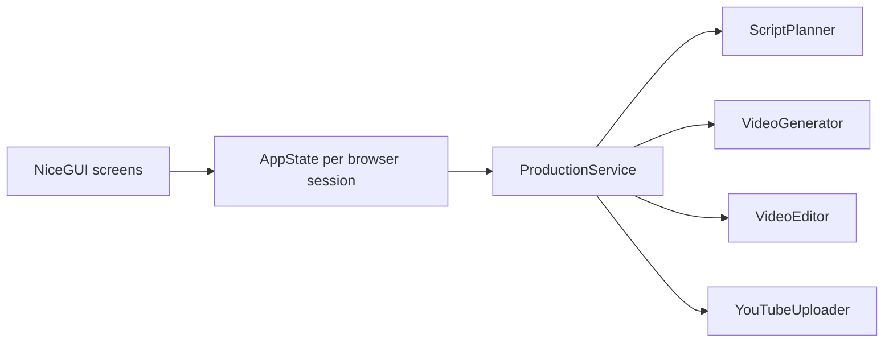

# ShortsMaker 🎬

**여러 Studio 창의 API 연결:** 제작 설정의 **고급 · API 연결**은 실행 중인 Studio 전체가 공유합니다. 다른 창에서 제작·업로드·인증 등의 작업이 진행 중이면 다른 연결로 변경할 수 없습니다. 작업이 끝난 뒤 적용하세요. 같은 연결을 쓰는 동시 작업은 가능합니다. 연결 변경은 디스크에 저장되지 않으며, 각 창에 남은 다른 연결 입력으로 제작을 시작해도 같은 확인이 적용됩니다.


Development map and agent handoff: [docs/README.md](docs/README.md), [docs/STATUS.md](docs/STATUS.md), and [docs/DECISIONS.md](docs/DECISIONS.md). Codex and Claude Code share [AGENTS.md](AGENTS.md) as the project instruction entry.

A local Studio app for source-grounded Korean Shorts using **Google Veo 3.1** and **Gemini image generation**.
ShortsMaker is being developed so users can select sources, edit scripts and scenes, prepare media, review and resume work, manage materials and budgets, and privately upload to YouTube through the app. Real production is the feedback loop for improving the product and video quality toward sustainable operation and eventual revenue. The current objective, remaining app gaps and acceptance evidence are in [docs/STATUS.md](docs/STATUS.md). Review source claims and the finished video before scaling publication.
Automatic uploads are private review copies; public publication remains a separate editorial decision.

## Studio 사용법

실행 중인 [ShortsMaker Studio](http://127.0.0.1:8080)를 여세요. 같은 Mac에서 접속하는 주소입니다. 처음 설치하는 경우 아래의 설치·실행 절차를 먼저 따르세요. 상단 **직접 제작 · API 과금** 상태에서는 사용자가 대본 생성·재생성, 장면 생성, 음성·영상 편집, 비공개 업로드를 직접 실행할 수 있습니다. 버튼 실행에 별도 에이전트 승인은 필요하지 않습니다. 월 예산·비주얼 비용 상한, 대본·장면 검토, 중복 요청·업로드 방지는 계속 적용됩니다.

| 메뉴 | 할 수 있는 일 |
| --- | --- |
| 제작 작업실 | 무료 RSS 기사 조회·선택, 저장된 대본 불러오기, 기사/RSS 기획, 내레이션·장면 설명 수정, 장면별 첫 프레임·무음 원본 검토, 영상 제작 |
| 기획·진행 현황 | 기획 입력, 실행 진행률·오류·현재 세션 이력 확인. 상단 **대본 기획**도 이 입력 화면을 엽니다. |
| 소재·출처 | RSS 분야·주소 관리. 추천 피드는 예시이며 기사별 출처 검증은 별도로 진행합니다. |
| 예약 운영 | 제작 시작 주기, 활성 상태, 검토 대기 이유와 연결된 영상 확인 |
| 완성본·업로드 | 저장된 완성본 재생, 게시 정보 복원, 기존 YouTube 링크 확인, 비공개 업로드 |
| 재료 보관함 | 폴더별 용량, 파일 검색·미디어 미리보기, 보호 사유 확인, 선택한 정리 후보 삭제 |
| 사용 안내 | 화면 안에서 간단한 사용 순서 확인 |

### 실행 중인 앱 확인

**대본을 교체할 때의 보관:** 앱에서 다른 대본을 열거나 바뀐 내용을 적용하기 전에는 현재 적용본과 미적용 대본/첫 프레임 입력을 기존 작업 초안 사본으로 남깁니다. 사본 저장에 실패하면 교체하지 않습니다. **저장된 작업 초안**에서 다시 열 수 있으며, 복원된 미적용 입력 대신 이전 적용본을 보려면 **미적용 수정 되돌리기**를 사용하세요. 처음 여는 대본이나 같은 대본 재열기는 중복 사본을 만들지 않습니다. 이는 교체 시의 텍스트 보관이며 타이핑 자동저장·음성/게시 입력 저장·검토 승인은 아닙니다. 서버 재시작 전에는 여전히 필요한 작업과 각본별 음성 설정을 명시적으로 저장하세요.

**저장된 대본이 음성·음악 설정 오류로 열리지 않으면** 현재 작업은 유지됩니다. 제작 설정의 **음성·음악 설정 복구 방법**에서 대상 대본을 확인하세요. **사본 보관 후 설정 복구·대본 열기**를 확인하면 원래 설정 파일과 현재 대본/첫 프레임 수정 입력을 별도 사본으로 남긴 뒤, 기본 음성 Alloy·음악 음량0·보유 내레이션 연결 해제로 대본을 엽니다. 현재 음성·음악 선택은 작업 초안에 포함되지 않으니 필요하면 취소 후 각본별 설정을 먼저 저장하세요. 실제 음성·음악 파일은 삭제하지 않으며 API를 호출하지 않습니다. 대본을 확인하고 보유 내레이션을 다시 연결하세요. 연결 없이 나중에 편집하면 새 TTS 비용이 발생합니다. 원래 설정을 읽어 사본으로 보관할 수 없으면 복구를 중단합니다.

**음악을 먼저 들어보려면** 제작 설정에서 곡이나 분위기를 정하고 **선택 BGM 미리듣기**를 누르세요. 대본 분위기에 맞추려면 먼저 대본을 여세요. 사용 허가 기록과 파일 해시가 맞는 로컬 원곡만 불러오며 API를 호출하지 않습니다. BGM 음량이0이어도 원곡을 들어볼 수 있고, 실제 제작 음량·검토·회차 연결은 바뀌지 않습니다. 플레이어에는 불러온 파일명을 표시합니다. 선택이나 대본을 바꿨으면 다시 불러오세요. 최종 내레이션과 섞인 소리는 완성본에서 확인하세요.

상단의 **시작 커밋**은 앱이 시작할 때 기록한 기준 커밋입니다. **사용 안내 → 실행 정보 · 배포 확인**에서 Studio 프로세스·UTC 시작 기록·수정본 포함 여부와 Python 코드 지문을 확인하세요. **현재 저장 코드와 비교**는 로컬 패키지의 Python 파일만 읽으며, 코드 변경 후 서버를 재시작하지 않았다면 차이를 알려줍니다. 자동 갱신·서버 재시작·API 호출은 하지 않습니다. 시작 정보가 없거나 읽기에 실패하면 확인 불가로 표시합니다.

이 지문은 전체 로드 모듈·환경 설정·라이브러리·영상 품질의 검증이 아닙니다. 재시작할 때는 진행 중인 제작을 확인하고 미완성 작업·게시 초안을 먼저 사본으로 저장하세요. 이전 실행본에는 이 표시가 없으므로 현재 저장소 커밋만으로 반영됐다고 판단하지 마세요.

### 예약 회차 확인과 완성본 연결

**예약 운영 → 저장된 일정 → 현재 회차 상태·연결**을 펼치면 현재 상태와 마지막 조회 시각을 확인합니다. 에이전트 회차는 기존 장부에서 누적 예약액·전체 회차 상한까지의 여유를 조회합니다. 월 장부, 별도 비교/검증 범위와 소진된 호출 횟수는 별도로 적용되므로, 회차 전체 여유가 새 지출 허가는 아닙니다. **회차 상태 새로고침**은 조회만 하며 기획·제작을 실행하지 않습니다. 실제 기록이 같은 동안에는 30초 점검이 열린 패널·연결 창을 닫지 않습니다.

실제 예약 시각이 지나 **에이전트 제작 인계 대기**가 된 회차에는 **예약 회차 기획 시작**이 나타납니다. 버튼을 누르면 월·회차 중 작은 잔여 상한과 범위를 확인하며, **이 회차 기획 실행**을 눌러야 소재 분석·각본·검증 API를 시작합니다. 표시 한도는 요청 예상가나 실제 청구액이 아닙니다. 서버에 저장된 API 설정을 사용하며, 각 요청은 기존 장부·회차 상한을 검사합니다. 기획 전에 업로드 인증을 확인하고 인증이 만료됐으면 지출 전에 멈춥니다. 취소·조회는 회차 기준을 만들거나 기획하지 않습니다.

기획 중 메뉴 이동은 가능하며 현재 편집 대본·미적용 입력을 바꾸지 않습니다. 완료 후 같은 회차의 **검토할 각본 불러오기**로 결과를 직접 여세요. 음성·이미지·영상 제작이나 업로드는 이 동작에 포함되지 않습니다. 실패·이전 실행 결과 확인 필요 상태는 자동 재시도하거나 잠금을 지우지 않으므로, 회차 상태·인증·운영 기록부터 확인하세요. 이미 업로드된 회차나 미래 슬롯을 이 버튼으로 다시 기획하지 않습니다.

에이전트 회차의 **검토할 각본 불러오기**는 작업실을 그 회차에 연결합니다. 상단 **예약 회차 제작** 표시와 **회차 잔여 확인**을 확인하고 각본을 검토한 뒤, 기존 첫 프레임·원본 생성·영상 제작·비공개 업로드 버튼을 사용하세요. 유료 단계는 서버에 저장된 API 설정과 기존 회차 실행 경로를 사용하고, 월·회차 중 작은 잔여를 적용합니다. Veo는 Lite 무음720p, 영상 모드8초·혼합 모드6초이며 자동 재시도하지 않습니다. 결과 영수증이 없거나 손상되면 회차 실행 잠금을 보존하고 추가 요청을 막습니다. 중지는 진행 중 호출을 강제 종료하지 않으며 반환 결과를 기다립니다. 기존 원본·제외 판정·해시·월 장부는 그대로 적용됩니다.

회차 연결은 서버 세션 값입니다. 재시작 후에는 같은 예약의 대본을 다시 불러와 검토하고 보유 클립·음성을 재연결하세요. 다른 대본을 열거나 수정해도 수동 제작으로 자동 전환되지 않습니다. 수정 대본은 아래 순서로 회차에 저장해야 제작할 수 있습니다. 별도 수동 제작은 **회차 연결 해제 → 수동 제작으로 전환**을 명시적으로 확인하세요. 이후 직접 실행은 월 예산만 적용하며 해당 회차에 자동 연결하지 않습니다. 전환은 기존 회차·예산·입력·재료·완성본을 삭제하지 않습니다. API 중지 설정에서는 회차 실행이 차단되며, 보유 재료만 쓰는 무료 편집은 연결 해제 후 수동으로 진행할 수 있습니다.

작업실에서 예약 대본을 다듬었다면 **수정 내용 적용 → 각본 확인 완료** 후 예약 운영으로 돌아와 **확인한 수정 대본을 회차에 저장**을 누르세요. 같은 출처의 검토한 수정본만 허용하며 확인 창에서 **이 수정 대본으로 회차 저장**을 눌러야 반영됩니다. 이전 대본과 원본 파일은 보존하고 수정 사본을 별도로 남깁니다. 같은 내용의 재저장은 이력을 추가하지 않습니다. 미적용 입력·변경된 확인 창·진행/미확인 실행·해당 대본의 미확인 업로드·이미 연결된 영상은 저장을 중단합니다. 이 작업은 API 호출·비용 한도 변경·영상 채택·일정 재개가 아닙니다. 수정본으로 만든 영상은 기존 출처·각본·파일 해시 검증을 그대로 통과해야 연결할 수 있습니다.

각본 검토 후 제작·비공개 업로드까지 끝났다면 **완성본·업로드**에서 해당 영상을 불러온 뒤 예약 운영의 **선택 완성본을 이 회차에 연결**을 누르세요. 파일명·YouTube ID를 확인하고 **이 비공개 완성본 연결**로 저장합니다. 연결은 새 업로드가 아니며, 대본·출처·품질·영상 해시와 저장된 비공개 업로드 기록을 다시 검사합니다. 파일/기록/회차가 바뀌거나 실행·업로드 결과가 불확실하면 연결을 중단합니다. 연결 후에도 일정은 검토 대기이며, **비공개 영상 검토 완료**와 YouTube 공개 전환은 따로 결정하세요. 이미 연결된 영상은 이 기능으로 교체하지 않습니다.

완성본을 채택하지 않고 다음 소재 제작을 이어가려면 **예약 운영 → 채택 보류·다음 회차 예약**을 선택하고 검토 메모를 확인한 뒤 **미채택 유지·다음 회차 예약**을 누르세요. 확인된 비공개 검토본이 붙은 반복 RSS 일정에서 사용할 수 있습니다. 대본·검토본·비용과 기존 주기·기준일은 보존하고, 다음 기준 시각에 새 회차를 대기시킵니다. 새 회차가 시작되면 이전 검토본과 메모는 실행 이력에 남습니다. 이 동작은 채택·공개·즉시 제작이 아니며, 새 회차는 기존 월/회차 예산과 인증·품질 검사를 적용합니다. 현재 보류한 검토본을 나중에 채택하려면 **미채택 검토본 채택**을 직접 선택하세요.

2026-11-14 현재 로컬 제작 기준은 **14일**, 다음 예약은 **11월18일10:06 KST**입니다. 독립 스케줄러는 대기만 만들고, 기존 Codex 운영·개선 점검은 **매일10:10 KST**에 해당 회차를 확인해 기존 실행 경로로 이어갑니다. Mac의 로그인·실행 가능 상태와 공급자 인증이 필요하며, 예약 등록만으로 실제 제작 완료가 보장되지는 않습니다.

직접 실행 일정도 같은 완성본 연결 흐름을 사용하며 에이전트 회차 예산을 새로 만들지 않습니다. 에이전트 기획·후속 제작 버튼은 기존 회차 제한 경로를 사용합니다. 실제 공급자 실행·복구·사용자 채택을 포함한 운영 검증은 별도이며, UI 연결만으로 자율 운영 전체가 완성된 것은 아닙니다.

이전 대본은 **예약 운영 → 실행 이력 → 회차 대본 검색 → 선택 회차 대본 이력 보기**에서 확인하세요. 최근 10개 카드 밖의 보관 회차도 검색하며, 전체 대본이 있는 회차의 마지막 저장본과 수정 전 버전을 볼 수 있습니다. **선택 대본을 작업실에서 검토**를 누르면 현재 적용 대본·미완성 JSON·첫 프레임 입력과 대상 대본의 변경 입력을 각각 작업 초안으로 보관한 뒤, 선택한 이력 원문을 엽니다. 백업에 실패하면 현재 작업을 유지합니다. 보관한 입력은 작업실의 **저장된 작업 초안**에서 다시 열 수 있습니다. 사본 열기는 현재 완성본 선택과 대본 확인을 초기화하며, 대상 대본에 명시 저장된 음성·음악·내레이션 선택은 복원합니다. 저장하지 않은 음성 선택은 이어지지 않습니다. 파일·원래 회차·이전 판정·비용 기록은 바꾸지 않습니다. 활성 회차 연결도 유지하므로 다른 회차의 제작 권한이 생기지 않습니다. 요약만 있는 기록이나 해시가 손상된 수정 이력은 대본으로 재구성하지 않습니다.

### 영상 없이 YouTube 연결 확인하기

**완성본·업로드 → YouTube 업로드 연결 → 저장된 인증 확인**은 로그인 창을 열지 않고 저장된 인증을 확인·갱신합니다. 연결이 필요하면 **업로드 계정 연결**을 누르고 Studio가 실행 중인 Mac의 기본 브라우저에서 기존 채널 계정과 YouTube 업로드 권한을 확인하세요. 창이 보이지 않으면 **로그인 창 직접 열기** 링크를 같은 Mac에서 여세요.

메뉴를 이동해도 대기 상태와 링크를 다시 볼 수 있습니다. **인증 대기 취소**는 해당 인증 자식 프로세스를 종료하며, 대기는 최대 5분입니다. 완료·실패·취소 후 로그인 링크를 지웁니다. 확인 결과는 현재 저장 인증의 준비 상태이며 실제 업로드 때 권한을 다시 검사합니다. 연결만으로 영상 업로드·제작·일정 재개를 실행하지 않습니다. OAuth 클라이언트 파일이 없으면 기존 클라이언트의 설치 설정을 복원하세요. 상세 경로와 Google 설정은 아래 설치 안내를 참조하세요.

### 미완성 작업을 저장하고 다시 열기

**제작 작업실 → 1. 대본·장면 검토 → 저장된 작업 초안 → 작업 초안 새 사본 저장**은 입력 중인 대본, 첫 프레임의 경로·검토 기준·메모와 소재 방식·기사 URL·RSS 분야를 별도 파일로 보관합니다. JSON이 미완성이거나 아직 적용한 대본이 없어도 저장할 수 있습니다. 장면 검토 화면의 **검토 입력 초안 저장**도 같은 사본을 만듭니다. 사본당 최대 2 MiB이며 기존 사본을 교체하지 않습니다.

소재만 고른 상태에서도 같은 버튼으로 저장할 수 있습니다. 완성하지 않은 URL도 입력값 그대로 남고, 목록에는 **소재 선택**으로 표시됩니다. 소재 입력만 담긴 사본을 열면 현재 대본·미적용 수정·검토·완성본 선택은 유지하고 소재 입력만 복원합니다. 바뀌는 기존 입력은 먼저 사본으로 보관합니다. 이전 형식의 사본에는 소재 정보가 없으므로 현재 소재 입력을 바꾸지 않습니다. RSS 후보 조회 중 입력을 바꾸는 복원은 조회가 끝난 뒤 진행하세요. 복원은 후보 목록을 다시 조회하거나 유료 기획을 실행하지 않습니다.

서버 재시작 후 **저장된 작업 초안 검색**에서 제목·저장 시각·짧은 식별자로 찾고 **선택한 작업 초안 열기**를 누르세요. 복원 전에 현재 작업과 같은 대상 대본의 미적용 입력도 새 사본으로 보관하므로, 이전 버전을 열어도 편집 중인 입력을 다시 찾을 수 있습니다. 파일이 바뀌거나 손상됐거나 저장에 실패하면 복원을 멈추고 현재 입력을 유지합니다. 목록 경고가 있는 원래 파일은 지우지 않습니다.

복원은 원래 적용 대본과 미적용 텍스트·첫 프레임 입력을 가져오며 승인·유료 실행·업로드를 재개하지 않습니다. 대본 변경을 적용하거나 되돌린 뒤 대본·장면 확인을 다시 진행하세요. 기존 장면은 파일과 검토 기록을 다시 확인해 재사용할 수 있습니다. 완료 영상·보관 음성·보유 클립은 기존 목록에서 다시 선택합니다. 게시 입력·API 키·인증·예산 권한은 이 사본에 포함되지 않습니다. 타이핑만으로 디스크에 자동 저장되지는 않습니다. 사본은 로컬 `outputs/evaluation/studio_drafts/`에 보관하며 Git에 넣지 않습니다.

### 제작 전 비용 확인

우측 **제작 설정 → 예산·예약 현황**에서 Google/OpenAI의 월 한도, 기준 사용액, 새 요청 예약액과 남은 예약 여유를 확인하세요. **모델별 새 예약액**은 보수적인 모델 비용 합계입니다. Google은 미국 태평양 시간, OpenAI는 UTC의 월 기준을 사용합니다. Google 예약에는 화면의 수동 환산값을 적용합니다.

앱을 열 때 한 번 조회하며 **장부 새로고침**으로 최신 값을 읽습니다. 공급자 API를 호출하거나 장부를 초기화·수정하지 않습니다. 표시값은 실제 청구액·결제 잔액이 아니며, 실패·불확실 요청도 예약에 남습니다. 월 여유가 있어도 예약 운영의 회차 한도는 별도로 적용됩니다. 요청 시 서비스가 예산을 다시 검사합니다.

**장부 확인 필요**는 잔액이 0이라는 뜻이 아닙니다. 설정 월과 기준 사용액, 기존 장부를 확인·복구하세요. 이전 지출을 확인하지 않고 새 장부를 만들지 마세요. **월 예산 미설정**은 해당 월 장부 보호가 꺼진 상태이며 무료 사용을 뜻하지 않습니다. 이 화면에서는 금액이나 운영 권한을 변경하지 않습니다.

### 기존 영상부터 확인하기

업로드용 목록에는 기본 품질 기록과 저장 해시가 있는 영상만 표시됩니다. 이전 파일이 목록에 없으면 **재료 보관함**에서 확인하세요. 목록에서 제외해도 파일을 삭제하지 않습니다. 불러올 때에는 실제 파일 해시를 다시 검사합니다.

게시 제목·설명·태그·AI 공개 선택은 **영상 경로와 해시별 서버 세션 초안**으로 유지되어 메뉴를 오가도 복원됩니다. **게시 입력 되돌리기**는 해당 영상에 저장된 원래 게시 정보로 돌아갑니다. 영상이 교체되면 이전 입력을 자동으로 넘기지 않으며, 저장하지 않은 세션 초안은 서버 재시작 후에는 복원되지 않습니다. 기존 업로드의 게시 정보 수정은 YouTube Studio에서 진행하세요.

**게시 초안 저장·복원 → 게시 초안 사본 저장**으로 제목·설명·쉼표 그대로의 태그·AI 공개 선택을 별도 사본으로 남기세요. 빈 입력도 저장할 수 있습니다(사본당 2 MiB). 재시작 후 같은 완성본을 불러오고 **이 영상의 저장된 게시 초안 → 게시 초안 불러오기**를 사용하세요. 영상 경로·해시가 같을 때만 복원되며, 현재 편집이 저장된 게시 정보와 다르면 먼저 새 사본으로 보관합니다. 파일 변경·손상·백업 실패 시 현재 입력을 유지합니다. 복원은 업로드·채택·공개나 기존 업로드 수정이 아닙니다. **게시 입력 되돌리기**는 제작 기록의 원래 정보로 돌아가며 저장한 사본은 지우지 않습니다.

1. **완성본·업로드 → 저장된 완성본**에서 제목·파일명으로 검색하고 **완성본 불러오기**를 누르세요. 목록은 파일 최근 수정순입니다. 재제작 없이 MP4와 일치하는 품질 기록·해시를 확인해 엽니다.
2. 화면의 영상을 끝까지 재생하세요. 업로드 이력이 있으면 **YouTube 검토본 열기**로 기존 영상을 볼 수 있습니다.
3. 제목·설명·태그·AI 사용 공개 선택이 저장된 업로드 요청에서 복원됩니다. 이미 올라간 영상의 제목·설명 수정과 공개 전환은 YouTube Studio에서 직접 하세요. 같은 파일의 업로드 버튼을 다시 눌러도 기록된 영상 ID를 재사용합니다.

### 모델 비용 없이 소재 고르기

**제작 작업실 → 대본·장면 검토 → RSS 자동 발견**에서 분야를 고르고 **무료 RSS 기사 먼저 보기 → 현재 분야 RSS 조회 · 모델 비용 없음**을 누르세요. 기존 RSS 수집기의 날짜·요약·URL·검토 이력 조건을 통과한 최근 후보를 읽습니다. OpenAI 키나 유료 생성 활성화 없이 사용할 수 있지만, 등록된 공개 RSS를 읽기 위한 인터넷 연결은 필요합니다. 누락된 피드가 있을 수 있으며 제목·요약은 본문 검증 결과가 아닙니다.

**RSS 기사 후보 검색**에서 제목을 고르면 출처·발행일·요약·원문 링크가 나옵니다. 원문을 확인한 뒤 **이 기사를 URL 입력으로 선택**을 누르면 직접 URL 입력으로 바뀝니다. 기존 적용 대본·검토·완성본은 바꾸지 않습니다. **각본 생성하기**를 별도로 눌러야 비용이 드는 본문 분석·각본 기획을 시작하며, 기존 예산·검증 조건을 그대로 적용합니다. 이 편집 검토용 목록과 자동 유료 후보의 제한된 표본은 다를 수 있습니다.

기획이 중단되면 생성 버튼 아래에 실제 중단 원인이 남습니다. 메뉴를 오가도 같은 서버 세션에서는 다시 확인할 수 있고, 기존 적용 대본·검토·완성본은 유지됩니다. 원인부터 확인하세요. **각본 생성하기**를 다시 누르면 새 요청 비용이 발생할 수 있으며, 이전 실패 비용이 자동으로 취소되지는 않습니다.

모델이 반환한 각본이 형식·음악 분위기·장면 수 문제로 중단되면, 받은 텍스트를 **미적용 작업 초안**으로 보관합니다. 오류 안내의 끝번호를 확인하고 **저장된 작업 초안 → 초안 목록 새로고침 → 검색 → 선택한 작업 초안 열기**로 복원하세요. 기존 작업은 먼저 사본으로 남깁니다. **대본·장면 편집**에서 음악 분위기·제목·장면 내용을 고친 뒤 **수정 내용 적용**을 누르고 출처·대본을 다시 확인하세요. 적용 전에는 초안만 바뀌며 실제 음악은 우측 음성·음악 설정에서 별도로 선택합니다. JSON 구조 자체나 장면 번호가 깨진 응답은 **JSON 편집기**에서 복구해야 합니다. 복구만으로 검증 통과·장면 승인·유료 재실행이 되지는 않습니다. 빈 응답이나 보관 용량·권한 오류로 사본을 저장하지 못하면 그 사실을 안내합니다. 사용자의 타이핑은 여전히 명시적으로 저장해야 하며, 이 자동 보관은 형식 문제로 중단된 모델 응답에만 적용됩니다.

조회 중 메뉴를 이동해도 결과를 이어서 확인하며 중복 조회는 막습니다. 오류는 이전 후보를 최신 결과처럼 남기지 않습니다. 소스 방식·URL·분야·후보 목록은 같은 서버 세션의 메뉴 이동에서 유지되지만, 아직 재시작용 작업 초안에는 포함되지 않습니다. 재시작 전 필요한 기사 URL은 따로 보관하세요.

### 새 영상을 제작하는 순서

1. **제작 작업실 → 1. 대본·장면 검토**의 **저장된 각본 검색**에서 제목·파일명으로 찾아 **불러오기**를 누르거나, RSS 분야/기사 URL로 기획합니다. 새 기획·재생성 버튼을 누르면 API 비용이 발생할 수 있습니다.
2. 출처 원문과 이야기 전개를 확인하세요. **대본·장면 편집**에서 제목·설명·기본 화면 구성을 수정하고, **수정할 장면**을 골라 내레이션·이미지 프롬프트·움직임·예상 길이를 입력하세요. 혼합 모드에서는 장면별 이미지/Veo 선택도 가능합니다. 예상 길이는 Veo API 요청 길이가 아니며 실제 요청 비용은 장면 생성 화면에서 확인합니다. **수정 내용 적용 → 현재 대본 새 파일로 저장** 순서로 수정본을 남기세요. 적용은 현재 세션을 바꾸고, 저장은 원본을 덮어쓰지 않는 사본을 만듭니다. 적용된 변경은 각본·장면을 다시 확인해야 하며 내용이 같은 재적용은 기존 검토·완성본을 유지합니다. **수정 내용 되돌리기**는 적용 전 초안만 취소합니다. **이 장면 뒤에 추가**로 빈 장면을 넣고 내레이션·화면 설명을 작성하세요. **앞으로 이동 / 뒤로 이동**은 재생 순서를 바꾸며 장면 번호는 유지합니다. 목록의 `N번째 · 장면 번호`로 순서와 번호를 구분할 수 있습니다. **장면 삭제**는 최신 내레이션을 보여주는 별도 확인 후 초안에서만 제거하며 마지막 하나는 삭제할 수 없습니다. 원본 대본 파일·영상·음성은 삭제하지 않습니다. 구조 변경도 **수정 내용 되돌리기**로 적용 전 취소할 수 있으며, 미완성 새 장면은 작업 초안으로 보관했다가 이어서 작성할 수 있습니다. 장면 추가·순서 변경은 제작량이나 혼합 모드의 오프닝을 바꾸므로 적용 후 제작 비용과 재료·음성을 다시 확인하세요. 고급 **JSON 편집기**도 같은 초안을 공유합니다. 미적용 수정이 있으면 새 제작·적용 대본 저장을 중단합니다. 재시작 전에는 미완성 작업 초안 사본을 저장하거나, 적용 후 대본 새 파일로 저장하세요. 저장은 모델 검증이나 장면 승인이 아닙니다.
3. 우측에서 화면 구성 방식과 음성·음악을 고르세요. **각본별 음성·음악 설정 저장**으로 선택을 보존할 수 있습니다. 같은 대본을 다시 불러오면 복원되며, 다른 대본에 자동으로 승계되지 않습니다. **각본 확인 완료 · 영상 제작으로 →**를 누르면 장면 검토 화면으로 이동합니다.
4. Veo 장면의 **첫 프레임 후보 생성**으로 이미지를 만들거나 **이미지 선택·가져오기**로 보유 PNG/JPEG를 검색하거나 **내 컴퓨터에서 이미지 가져오기**로 선택하세요. 가져온 파일은 검사를 통과한 뒤 보관함에 새 사본으로 저장되며, 기존 이미지와 승인 기록을 덮어쓰지 않습니다. 선택하면 해당 장면에 미리보기만 연결되며 자동 승인·API 호출은 없습니다. 첫 프레임은 20 MB 이하, 최소 360×640의 세로 9:16 이미지여야 합니다. PNG/JPEG 전체를 디코딩해 검사하며, 손상된 파일은 미리보기·승인과 유료 영상 요청 전에 차단합니다. 보관함 밖의 파일은 기존 로컬 경로 입력도 가능합니다. 생성 버튼 앞의 모델·출력 예약 추정을 확인하세요. 후보는 현재 대본·장면별 1회이며 자동 재시도하지 않습니다. 보여야 할 내용·피해야 할 묘사·검토 의견을 적고 **이미지 미리보기 → 이 첫 프레임 승인**을 진행합니다. 후보 생성은 승인이 아니며, 승인 후에만 **이 장면 VEO 원본 생성**으로 넘어갑니다. 실패·불확실한 이미지 요청은 기록을 확인하기 전 재제출하지 않습니다.
5. 무음 원본을 끝까지 보고 내레이션의 내용과 일관성이 유지되는지 판정하세요. 검토 의견과 **원본 승인/원본 제외**는 현재 대본·첫 프레임·원본 파일에 묶여 저장됩니다. 이미 승인된 원본은 재사용합니다. 첫 프레임과 원본의 승인 수가 표시되고, 승인된 장면은 접혀 있습니다. 장면 제목을 누르면 이미지·영상·의견을 다시 볼 수 있습니다. 제외·무효·미검토 장면은 펼쳐 표시합니다. 첫 프레임을 새로 승인하면 원본 목록도 다시 확인합니다. 파일이나 대본이 달라지면 다시 확인해야 합니다. 첫 프레임의 후보 경로·검토 기준·의견은 대본·장면별 서버 세션 초안으로 메뉴 이동 시 복원됩니다. 미적용 입력이 있으면 해당 장면 원본 생성과 전체 자동 편집은 멈춥니다. **이미지 미리보기 → 이 첫 프레임 승인** 또는 **첫 프레임 검토 입력 되돌리기**로 정리하세요. 되돌리기는 저장된 승인·원본·완성본을 지우지 않습니다. 재시작 전에 **검토 입력 초안 저장**으로 미승인 입력을 보관할 수 있습니다. 검토를 마친 입력만 명시적으로 승인하세요.
6. 필요한 장면이 준비되면 **영상 제작 시작**으로 음성·음악·자막을 합칩니다. **보유 영상 직접 연결**에서 장면 파일을 넣고 카드의 영상으로 확인할 수 있습니다. 클립 교체 시 이전 완성본 선택은 해제됩니다. 같은 대본의 이전 파일 연결은 **저장된 보유 영상 작업 → 선택한 작업 이어가기**로 재시작 후 복원합니다. 대본·출처가 달라지거나 기록이 손상된 작업은 복원하지 않으며, 기록 없는 과거 폴더를 추측해 연결하지 않습니다. 파일 연결은 품질 승인이 아닙니다. 제작 서비스는 재생 가능한 파일인지 음성 API 호출 전에 검사하며, 새 음성이 필요하면 API 비용이 발생할 수 있습니다.
7. 완성본을 끝까지 검토한 뒤 **완성본·업로드**에서 제목·설명·모든 출처·AI 사용 공개 여부를 확인하고 **YouTube에 비공개 업로드**를 사용하세요. 기술 품질 통과와 편집상 채택은 별개이며, 공개는 사용자가 결정합니다.

### 사용자가 중간에 개입하는 범위

**장면·영상 제작**에서 제작을 시작한 뒤 메뉴를 오가도 작업은 계속되고, 다시 열린 화면에 완료 영상이 반영됩니다. 품질 미통과 파일의 미리보기에는 별도 안내가 표시되며 업로드할 완성본으로 선택되지 않습니다. 우측 음성·음악·화면 설정은 새 편집에 적용되므로 이미 만든 영상의 미리보기를 바꾸려면 다시 편집해야 합니다.

**보유 영상 직접 연결**에서 파일을 교체하면 임시 파일의 길이와 첫 프레임을 열 수 있는지 확인한 뒤 장면 파일을 교체합니다. 검사·저장 중에는 다른 제작을 시작할 수 없으며 메뉴 이동은 가능합니다. 손상된 파일이나 저장 오류는 기존 클립·완성본 선택을 유지하고 현재 서버 세션의 장면 카드에 실패 이유를 남깁니다. 파일 전송 목록의 `100%`는 연결 성공 판정으로 사용하지 않고 처리 후 비웁니다. 정상 교체에 성공하면 이전 완성본 선택만 해제되며 실제 완성본 파일은 남습니다. 재료 연결 후에는 영상을 끝까지 재생해 내용과 편집 적합성을 확인하세요. 작업이 끝나기 전 화면을 이동했다 돌아와도 완료 후 새 클립을 표시합니다.

장면별 **기존 장면 영상 찾기 → 선택 영상 미리보기 → 이 장면에 영상 연결**로 이전 작업의 클립 하나를 가져올 수 있습니다. 목록에는 현재 대본과 정확히 일치하는 다른 보유 영상 작업의 같은 장면과, 현재 장면에서 승인된 Veo 원본이 표시됩니다. 현재 작업 자체는 제외합니다. 미리보기와 닫기는 연결을 바꾸지 않으며, 연결할 때 파일·기록·원본 판정을 다시 확인하고 500 MB 이하의 사본을 현재 작업에 저장합니다. 원본은 보존하며 기존 영상 검사를 그대로 거칩니다. 미확인·제외된 Veo 원본은 이 경로로 연결하지 않습니다. 이 동작에는 API 호출이나 영상 편집·업로드가 포함되지 않습니다. 전체 파일은 **재료 보관함**에서 확인하고, 다른 보유 파일은 기존 **비디오 선택**으로 연결하세요.

보유 영상 연결 화면에서는 작업실을 아래로 스크롤해 모든 장면 카드를 확인하세요. 모바일에서도 내용 높이만큼 펼쳐지며, 내레이션 목록이 길어도 마지막 장면의 파일 선택·기존 영상 찾기에 접근할 수 있습니다.

대본의 내레이션·화면 설명·움직임은 JSON 편집기로 수정하고 별도 사본으로 저장할 수 있습니다. 각본 확인, 첫 프레임 승인, 무음 원본 승인/제외, 보유 클립 교체, 음성·음악 선택, 비공개 업로드 전 게시 정보 검토에서 개입할 수 있습니다. 진행 중인 제작·업로드에서는 대본이나 파일 연결을 바꾸지 못합니다. 중지 요청은 현재 공급자 호출이 끝난 뒤 다음 단계를 막는 방식이며, 이미 제출된 API 호출을 취소하거나 비용을 되돌린다는 뜻은 아닙니다.

장면·영상 제작 상단은 현재 단계의 **다음 행동**과 **Veo 원본 승인 수**를 표시합니다. 필요한 Veo 원본을 모두 승인한 뒤 영상 제작 시작이 활성화됩니다. 실행 직전에는 실제 파일·해시와 비용 한도를 다시 검사합니다.

JSON 편집 입력은 **대본별 서버 세션 초안**으로 유지되어 메뉴를 오가도 사라지지 않습니다. 적용하기 전에는 실제 대본·영상·승인 상태를 바꾸지 않으며, 미적용 수정이 있으면 각본 확인 전에 적용하거나 **미적용 수정 되돌리기**를 눌러야 합니다. 이미 확인한 대본에도 미적용 수정이 생기면 새 첫 프레임·원본 생성과 편집 시작을 보류합니다. 기존 승인 기록과 완성본은 유지하며, 수정을 적용하거나 되돌린 뒤 진행하세요. 초안은 디스크 자동 저장이 아니므로 서버 재시작 전에는 **현재 작업에 적용 → 현재 대본 새 파일로 저장**하세요.

각본 확인 후 **장면·영상 제작 → 내레이션 · 준비·재생·재사용 → 음성만 준비 · 비용 확인**을 누르면 영상·BGM 없이 현재 음색의 내레이션만 준비할 수 있습니다. 새 요청 장면 수·최대 예약액과 월/회차 잔여를 확인하고 **확인 후 음성만 준비**를 누르세요. 음성 요청당 기존 최대2회 시도를 포함한 예약이며 실제 청구액이 아닙니다. 같은 문장·장면·모델·음색의 완료 음성은 재사용합니다. 완료 후 자동 연결된 장면별 음성을 재생하고, 선택을 다시 열려면 **각본별 음성·음악 설정 저장**을 누르세요. **음성 준비 중지 요청**은 현재 요청의 음성을 저장한 뒤 다음 장면부터 멈춥니다. 완료한 장면은 유지되고 다음 비용 확인 때 미요청 장면만 계산합니다. 결과가 불확실하거나 손상된 요청은 자동 재제출하지 않으며 기존 결과 대조가 필요합니다. 예약 회차에 연결된 작업은 같은 회차 실행·한도를 사용합니다. 이 버튼은 영상 편집·YouTube 업로드·검토 승인을 실행하지 않습니다.

장면·영상 제작 상단의 **내레이션 · 준비·재생·재사용**에서 세트를 고르고 **이 음성 세트 연결**을 누르면 장면별로 재생한 뒤 기존 음성으로 편집할 수 있습니다. 현재 내레이션과 모든 장면의 완료 기록·텍스트·파일 해시가 일치하는 세트만 표시하며, 연결 시 실제 음량·길이도 검사합니다. 연결한 음성은 우측 음색 설정으로 다시 생성하지 않습니다. 음색을 바꾸려면 **새 음성 생성으로 전환**을 누르세요. 같은 음성을 다시 연결하거나 이미 새 음성 모드인 상태를 다시 선택해도 완성본 선택은 해제되지 않습니다. 음성 선택이 실제로 바뀔 때만 새 편집이 필요합니다. Studio가 새로 만든 음성도 편집 전에 `outputs/evaluation/narration_sets/`에 보관하므로 다음 편집에 재사용할 수 있습니다. 편집이 실패해도 보관된 세트는 남습니다. 연결 또는 새 음성 전환 후 우측 **각본별 음성·음악 설정 저장**을 누르면, 같은 대본을 다시 불러올 때 내레이션 선택도 복원됩니다. 저장하지 않은 선택은 서버 세션에만 남습니다. 저장된 음성 기록·파일이 바뀌거나 없어지면 해당 연결을 유지한 채 오류를 표시하고 편집을 중단하며 새 TTS로 자동 전환하지 않습니다. 파일을 복구하거나 목록에서 검토 후 다시 연결하거나 **새 음성 생성으로 전환**을 직접 선택한 뒤 설정을 다시 저장하세요. 설정 저장은 영상·음성 생성이나 검토 승인이 아닙니다.

Studio의 직접 제작 기능은 기본 활성화됩니다. 환경 파일이나 실행 환경에 `PAID_PRODUCTION_ENABLED=false`를 명시하면 검토 모드가 되며, 직접 제작하려면 `true`로 바꾸고 Studio를 재시작하세요. 일반 CLI 생성 도구는 명시적으로 활성화하지 않으면 계속 차단됩니다. 첫 프레임 후보 생성과 보관된 내레이션 재사용은 Studio에서 직접 진행할 수 있습니다. 새 음성과 비주얼이 모두 필요 없는 편집은 검토 모드에서도 가능하며, 새 API 요청이 필요하면 기존 비용 상한이 적용됩니다. 에이전트 예약 회차의 예산을 적용한 유료 재개는 기존 위임 운영 경로를 따르며, 수동 제작 활성화가 자동 운영 한도나 일정을 바꾸지는 않습니다.

### 작업 중 화면을 이동하거나 오류가 났을 때

같은 서버 세션에서는 기획·진행 현황에서 만든 대본도 작업실에서 피드백 재생성을 이어갈 수 있습니다. 재생성 문맥과 실제 시도 횟수를 유지하며, 요청 중 작업실을 다시 열면 완료 후 대본을 복원합니다. 재생성 취소는 새 요청 전에는 제출을 막고, 요청 후에는 완료된 응답 파일을 보존하면서 현재 대본에 자동 적용하지 않습니다. 이미 사용한 호출·시도 횟수는 되돌리지 않습니다.

원본 생성 중 화면을 이동했다면 **원본 상태 새로고침**으로 저장된 요청·클립·판정을 다시 확인하세요. 이 버튼은 원본 생성 API를 다시 호출하지 않습니다. 보유 영상 편집 버튼은 작업 중 비활성화되고, 작업이 끝나면 현재 대본 확인·클립 연결·제작 허용 조건에 따라 다시 활성화됩니다.

RSS 설정을 읽지 못하면 오류와 원본 파일 위치를 표시합니다. 손상된 파일을 자동으로 초기화하거나 덮어쓰지 않습니다. 원본을 복구한 뒤 소재·출처의 **RSS 목록 새로고침**을 누르거나 사용하던 메뉴를 다시 여세요. RSS 오류 중에도 저장된 대본·완성본 검토는 가능하며, RSS 기획·설정 변경은 복구 후 진행합니다.

### 재료를 확인하고 저장 공간 정리하기

1. **재료 보관함**에서 전체·폴더별 파일 크기와 디스크 여유를 확인하세요. `outputs`, `temp`, `assets`, `bgm`, `logs` 안의 파일을 표시합니다. 폴더·종류·파일명으로 필터링하고 열 제목을 눌러 크기순으로 정렬할 수 있습니다. 좁은 화면에서는 표 안을 좌우로 스크롤하세요.
2. 미디어 하나의 체크박스를 선택하고 **선택 파일 미리보기**를 누르세요. 영상·이미지·음성을 확인할 수 있습니다. 로그·기록·링크 파일은 내용을 열지 않습니다.
3. **정리 후보만 보기**를 켜고 필요 없는 파일을 선택한 뒤 **선택 파일 정리 검토**를 누르세요. 파일명·삭제할 크기를 확인하고 확인 체크박스를 켜야 **선택 파일 영구 삭제**가 활성화됩니다. 휴지통을 거치지 않으며 복구할 수 없습니다.

정리 후보는 **24시간 지난 참조 없는 임시 미디어**와 **제작 기록이 일치하고 업로드하지 않은 참조 없는 출력 폴더 최상위 편집 MP4**입니다. 삭제 직전 파일 해시·변경 여부·사용처·실행 상태를 다시 검사합니다. 이전 편집본에 저장 해시가 없으면 현재 해시를 확인 목록에 고정하며, 이는 업로드 품질 승인으로 쓰이지 않습니다. 삭제 결과는 `outputs/evaluation/storage_cleanup/`에 남고 기존 제작 기록은 변경하지 않습니다. 일부 실패는 삭제된 파일 크기만 보고합니다.

원본 캐시·수동 클립 작업·재사용 이미지/BGM·대본·승인/제외·비용 기록·업로드 영상·결과가 미확인인 업로드는 보호합니다. 검토 문서나 다른 기록에서 참조하는 파일도 보호하므로 **정리 후보가 없을 수 있습니다**. 이는 디스크에 파일이 없다는 뜻이 아닙니다. 기록이 손상됐거나 제작·업로드/미확인 회차 실행이 있으면 정리를 보류합니다. 과거 검토 자료의 일괄 삭제나 보호 해제 기능은 제공하지 않습니다.

미디어는 파일, 연결·검토 상태는 JSON 등 기존 기록으로 관리하며 **비용 장부와 일정 실행 잠금에는 이미 SQLite를 사용**합니다. 보관함은 별도의 자산 DB를 만들지 않고 이 기록들을 조회합니다. 파일·하위 폴더명 참조를 보수적으로 찾는 현재 방식은 완전한 사용 관계 그래프가 아니며, Studio와 무관한 외부 스크립트의 동시 파일 사용까지 잠그지는 않습니다. 외부 제작 작업을 함께 실행하지 않은 상태에서 정리하세요. 파일 크기 합계와 실제 회수 공간은 APFS 복제·압축 등에 따라 다를 수 있습니다.

편집 시작 때 날짜만 보고 오래된 임시 파일을 지우던 처리는 제거했습니다. 현재 편집 실행이 직접 만든 임시 파일만 기존 방식으로 자동 정리하고, 남은 과거 파일은 보관함에서 확인합니다.

### 비용·예약·저장 시 주의할 점

- **검토 모드 · API 생성 중지**이면 새 대본·음성·이미지·영상 API 생성이 차단됩니다. 새 각본/원본 생성·Studio 편집 버튼은 비활성화되며, 저장된 자료 재생·판정과 기존 원본 다시 확인은 가능합니다. Studio 편집은 준비된 음성 파일을 직접 넘기지 않으므로 새 음성이 필요한 경로입니다. 별도 로컬 편집 CLI는 기존 음성·영상으로 무료 비교를 할 수 있습니다. 현재 위임 운영의 유료 제작은 승인된 회차의 `operate_schedule.py` 경로에서 진행하며, Studio 버튼이 그 회차 한도를 자동 위임받는 것은 아닙니다. 재개를 위해 전역 유료 스위치를 임의로 켜지 마세요.
- 화면에는 실제 설정된 대본·영상 모델이 표시됩니다. 일반 Studio 기본 영상 모델과 위임 회차에서 고정하는 Lite 모델은 다를 수 있으므로, 새 호출 전에 모델과 비용을 확인하세요. 전체 비주얼 추정은 저장분 차감 전 금액이며, 장면별 재사용 여부는 원본 검토 화면에서 확인합니다.
- **예약 운영**의 기본 주기는 **2주**입니다. 예약 시각은 기획 시작 시각이며 업로드 완료 시각이 아닙니다. 검토·예산·인증에서 멈출 수 있고, 미해결 회차는 삭제하거나 토글해 건너뛸 수 없습니다. 설정 화면을 보는 것만으로 일정을 활성화하지 않습니다.
- 일반 Studio 예약은 서버와 내장 스케줄러가 필요합니다. `review_operator=agent`로 위임한 일정은 독립 시계 호스트가 대기 작업만 만들고, 에이전트가 검토·제작을 이어갑니다. 이 운영에서 내장 시계를 중복 시작하지 마세요. 현재 회차 상태와 다음 작업은 [STATUS](docs/STATUS.md)가 관리합니다.
- 저장하지 않은 대본·장면·게시 입력과 화면 이력은 브라우저 세션 상태입니다. 명시적으로 저장한 작업·게시 초안, 대본 사본과 보유 클립 작업은 디스크에 남습니다. 서버 재시작 후 저장된 작업 초안/대본/완성본을 다시 불러오세요. **고급 · API 연결 → 연결 설정 적용**은 실행 중 Studio 설정에만 반영되고 `.env`를 저장하지 않습니다. 키·토큰·비공개 출력은 Git에 넣지 않습니다.

---

Planning uses GPT-6.1 Terra for article analysis, scripts/scene prompts and source/continuity validation with low reasoning and Standard-tier bounded JSON requests. Fast scoring/enrichment retains GPT-4o-mini; voice retains tts-1/nova. The writer specifies visible narration evidence and repeated subject/layout anchors; the raw and whole-cut reviews still decide whether returned imagery is coherent. The model path has offline compatibility coverage and a separately authorized private video comparison; current editorial verdicts and runtime evidence belong to [STATUS](docs/STATUS.md). A model change alone does not establish better finished-video quality.
Automatic API uploads conservatively mark AI-generated visuals for YouTube's synthetic-media disclosure. The manual Publishing tab requires an explicit yes/no choice about realistic AI-generated or altered scenes; review that choice again before making a video public.
Studio and scheduled API uploads are always **private**. The Studio Publishing tab plays the exact finished file selected for manual upload; watch it and check the metadata before uploading. Review the complete video, source claims, music rights, and AI disclosure choice in YouTube before making it public; the technical quality check does not make an editorial decision.
New API uploads label Korean title and description text with YouTube's `defaultLanguage=ko`; this does not alter earlier uploads or set the spoken-audio language. The current Sillim public-metadata proposal and remaining release checks are in [docs/SILLIM_PUBLICATION_CANDIDATE.md](docs/SILLIM_PUBLICATION_CANDIDATE.md).
The upload action requires the matching, quality-passed `*.production.json` record. New records bind the finished MP4 by SHA-256; changing its bytes blocks upload or reuse of a recorded YouTube ID. An older unuploaded record gains that binding after a fresh quality check, while an older uploaded record without a hash requires a YouTube Studio check. Repeating the action for an unchanged file with a recorded ID shows the existing private upload instead of posting another copy; metadata typed on that repeat is not submitted. Before each new upload, an adjacent `*.upload-pending.json` file records the video hash and prepared private request fields. Successful uploads also save those fields in the ignored production sidecar, so the submitted description can be checked later. If YouTube returns no ID or saving the ID fails, the pending file prevents another upload until the result is checked in YouTube Studio. If Studio confirms no upload occurred, remove the pending file before retrying; if it confirms an upload, record its verified ID in the matching production sidecar before clearing the pending file. Do not clear it based only on a network error.
Studio's **각본에서 게시 정보 가져오기** fills the selected primary article URL and any `supporting_source_urls` when absent; review or edit the description before a manual upload. A new upload must include every source URL saved in its production record. The explicit approved-script upload path checks supplied metadata and all script source URLs before rendering. A reviewed description is kept as written when it passes this check. Older production records without supporting-source metadata cannot establish whether a multi-source story is fully credited; rebuild such a cut from the reviewed script before uploading it.
The private scorecard separates unique image/hybrid comparison pairs from all other finished cuts, including routine automatic videos, and shows a distinct-primary-source cost rollup across revisions. It counts audience results only after `public_release_confirmed=yes` is entered for a reviewed video; an upload ID alone is not a public-release record. See [the evaluation workflow](docs/QUALITY_EVALUATION.md).

---

## ✨ Key Features

- **Deep Content Research:** A 3-stage enrichment pipeline (Extraction, Analysis, Enrichment) gathers context and web leads. Script validation compares concrete claims with the selected primary source excerpt.
- **Smart Storytelling:** Automatically structures scripts into high-retention formats (Hook -> Mystery -> Secret -> Impact).
- **Flexible Visuals:** A short Veo opening followed by Gemini images by default; full-image and full-video modes remain available.
- **Automated Composition:** Native integration with `moviepy` for seamless audio-visual merging, subtitling, and BGM.
- **Modern GUI:** A clean, productive Studio interface built with **NiceGUI**.

---

## 🏗️ Architecture

ShortsMaker is a modular monolith. The NiceGUI screens keep browser-session UI state in
`AppState` and start work through `ProductionService`. That service owns the production
sequence and progress/cancellation state; it calls the planner, media generator, editor,
and uploader. Those components contain their own external API and file operations.



The scheduler uses the same `ProductionService` without a GUI session. Browser state is
held in memory and is lost on a server restart. API settings are process-wide, so run
separate server instances when different users need different credentials.
Script review attempts retain the draft and the exact source excerpt in ignored `outputs/scripts/reviews/review_*.request.json`, with a matching `.verdict.json` containing returned feedback. Read those records when correcting a rejected draft. A request without a verdict requires checking the episode audit, provider outcome and ledger before another call. Rejected drafts are separate from the accepted `script_*.json` list.

Use **각본별 음성·음악 설정 저장** after choosing the voice, exact BGM, mood, level and optional prepared narration set. The saved set is bound to its manifest hash; every use rechecks that identity plus scene text/audio hashes. Missing/changed narration stays selected with a visible error until explicitly repaired, reconnected or switched to new speech; it never silently falls back to paid TTS. Loading that same script from recent scripts or its schedule restores these choices after a restart; loading a different script without saved choices uses the audio defaults. Records stay under ignored `outputs/audio_choices/` and contain no API key or review/spend approval. A corrupt record or unavailable saved track blocks loading instead of substituting other music. Script review must still be confirmed after loading.
Studio reports a scheduler start error if its job backend is unavailable or a saved job cannot be registered. If a newly created or edited job cannot be registered while the scheduler is running, that schedule is saved as disabled with `registration_failed`; correct the problem before re-enabling it. A schedule created disabled stays unregistered. The Active Schedules badge and green indicator count jobs with an actual next run; a merely enabled saved configuration is shown as waiting when the scheduler is stopped.
The default `Every 2 Weeks` option starts at the next selected local clock time after first activation and repeats every 14 days from that saved anchor, including after a Studio restart. `Every 4 Weeks` remains available for 28-day schedules. For ordinary Studio jobs, Studio and its Scheduler must be running for a job to fire; missed times are not replayed. The trigger begins a **planning** cycle, not a guaranteed video upload. It still pauses at script review and all later visual, budget, and private-upload gates remain in force.
Agent-operated schedules explicitly marked `review_operator=agent` use a separate, queue-only clock host. The host has its own Asia/Seoul timezone and can run while Studio is closed. At the saved interval slot it writes one disabled `operator_pending` attempt without provider calls. An explicit `first_run_at` may defer the first slot after a manual pilot. After a host gap, recovery queues only the latest due slot, records older skipped dates and lateness, and never buys a backlog. A queued or interrupted attempt cannot be skipped by toggling its switch.

The approved operator uses `scripts/operate_schedule.py` to continue that same attempt. `plan` captures immutable Google/OpenAI ledger baselines and spawns ordinary planning under reduced process ceilings; source/scene review still pauses as `script_review_pending`. This episode's new ceilings are Google ₩3,000 and OpenAI $0.30 inside monthly ₩10,000/$1. All reservations created since its baseline, including unknown/unallocated local requests, are conservatively counted across calendar months. Missing ledger rows or a stale monthly opening block new work. This is a request-reservation guard for normal project clients, not a provider account billing cap or an authorization/quality decision.

```bash
.venv/bin/python scripts/operate_schedule.py status
.venv/bin/python scripts/operate_schedule.py plan SCHEDULE_ID
.venv/bin/python scripts/operate_schedule.py run SCHEDULE_ID -- .venv/bin/python EXISTING_PRODUCTION_SCRIPT
.venv/bin/python scripts/operate_schedule.py attach SCHEDULE_ID outputs/FINISHED_VIDEO.mp4
```

Replace the uppercase placeholders with the current queued ID and reviewed local artifacts. Run paid planning/media only under the existing operating authorization, after current-period usage and model prices are verified. Use `run` for subsequent normal first-frame/raw/TTS/editor/private-upload paths; it pins Lite and limits new visual reservations to the remaining scope without turning on Studio's global paid switch. The operator still inspects the actual source, first frame, raw and complete edit; a generic child command is not a quality verdict. Preserve initial and revised scripts, and explicitly reconcile the saved pending script if editorial changes are needed; attach requires its exact final script/video hashes. Each child has an exclusive pending marker and an exit-code audit. If a parent disappears, reconcile its child, provider and artifact state before touching that marker. Do not interpret a nonzero exit as permission to retry.

`attach` records a confirmed matching private upload on the paused schedule and exposes its YouTube link. It does not accept the video. Reattachment and acceptance must retain that exact resolved MP4 path, video hash and YouTube ID; another cut of the same script cannot silently replace it. Once attached, `run` refuses further production commands for that episode before launching a child or creating an attempt marker. The owner then uses **비공개 영상 검토 완료**; only that decision marks acceptance and resumes the next RSS slot. Public release remains separate.

On macOS, `.venv/bin/python scripts/operate_schedule.py install-host` installs the queue-only `com.shortsmaker.scheduler` user LaunchAgent with the paid switch off. Use `launchctl print gui/$(id -u)/com.shortsmaker.scheduler` to verify its current state, not a saved PID or config alone. Logs are under ignored `logs/scheduler_host.*.log`. The host checks external schedule edits every 30 seconds. A Codex heartbeat continues editorial work and development; it needs the desktop app available. Login, sleep and offline periods can delay execution; a running LaunchAgent is not proof of a real completed scheduled episode. The host does not wake the computer or run paid production by itself.

For this local operating setup, Studio also has a separate user LaunchAgent, `com.shortsmaker.studio`, loading `.venv/bin/python -m shorts_maker.gui` from the project root with `PAID_PRODUCTION_ENABLED=true` for owner-operated production. Its definition is `~/Library/LaunchAgents/com.shortsmaker.studio.plist`, with `RunAtLoad=true`, restart on unsuccessful exit and a 30-second throttle; ignored logs are `logs/studio_host.{out,err}.log`. Open [ShortsMaker Studio](http://127.0.0.1:8080). Check the live job with `launchctl print gui/$(id -u)/com.shortsmaker.studio`. After testing a code change, wait for any Studio work to finish, then use `launchctl kickstart -k gui/$(id -u)/com.shortsmaker.studio` to load it; verify the HTTP response and retained artifacts afterward. This restarts Studio and clears unsaved browser-session state, so save script audio choices first. If the LaunchAgent definition or environment changed, reload the saved definition with `launchctl bootout gui/$(id -u)/com.shortsmaker.studio` followed by `launchctl bootstrap gui/$(id -u) ~/Library/LaunchAgents/com.shortsmaker.studio.plist`; kickstart alone reuses the loaded environment. Leave `com.shortsmaker.scheduler` running independently and do not start a second clock from Studio. To intentionally unload Studio, use `launchctl bootout gui/$(id -u)/com.shortsmaker.studio`; the installed definition still loads on the next login. This is a logged-in local service, so sleep/logout/power loss can interrupt availability; Codex development checks still require the desktop app available.

For published-video feedback, enter total starts, engaged views and average duration from the same completed first seven YouTube reporting dates in the private scorecard. `scorecard init` adds `engaged_views_7d` to an older CSV. The combined average uses engaged views as its weight. Record the provider date range and timezone in the review note; [the evaluation guide](docs/QUALITY_EVALUATION.md) describes the window and missing-data rules.

Development checks have their own cadence, independent of the production clock; [STATUS.md](docs/STATUS.md) owns the current configured times and verification. Finished-cut feedback can trigger a code, prompt, workflow or retained-asset improvement immediately. Do not wait for the next upload or seven-day analytics to fix a supported issue. Verify and commit each concrete improvement, then check its effect in a later complete cut. More frequent development does not authorize extra paid generations, uploads or episode allowances. With no new evidence or unfinished improvement, leave the working system alone.

Each new muted Veo scene request carries the displayed scene estimate as its request ceiling, separately from the full-video visual cap and monthly ledger. If the current estimate rises above that displayed amount, the request stops before creating an attempt marker; refresh and review the new estimate. This ceiling controls the program's output reservation, not the provider invoice or editorial approval.
Use RSS discovery for repeating episodes. In Studio, choose one registered RSS category or `전체 분야`; the same choice applies to planning and schedules. The former free-text keyword field did not filter feeds. A saved legacy schedule with a non-category keyword stops before scoring, so recreate it with a registered category. Scheduled planning runs in one app process one at a time so the next run sees the updated source history and budget. A schedule with one direct article URL pauses after its first planned script, and another schedule for that same article stops as `duplicate_url` before paid work. Change the URL for a new story. Empty, local, and non-HTTP article URLs are rejected when saving the schedule.
The current scheduled run creates a source-validated script, saves it in the ignored schedule record, and pauses as `script_review_pending` **before narration, visuals, or upload**. On its Studio card, choose **검토할 각본 불러오기**, open Workspace → Script Editor, review the source, narration, and each scene description, then click **각본·장면 설명 확인 완료**. For each new Veo scene, Generation requires a local 9:16 PNG/JPEG first frame: preview it beside the narration and sources, state what must appear and what must be avoided, and approve it. Use **이 장면 Veo 원본 생성** for one scene, watch its muted raw clip, write a verdict note, and choose **원본 승인** or **원본 제외**. Repeat for every Veo scene before **Start Production**; it will use only approved cached Veo clips and then prepare narration, remaining images, and the complete edit. Changing the script, frame, or raw clip invalidates the matching verdict. Check the shown model/seconds/cost estimate and current budget before clicking a paid generation button. Publishing handles a separate private-upload review. A pending script cannot be resumed into another paid planning run.
After the whole cut has been reviewed and uploaded privately, use **비공개 영상 검토 완료** on that schedule card and enter the finished MP4 path. Studio requires a matching source, a passing production record and unchanged video hash, plus a confirmed private YouTube upload ID before saving the editorial acceptance. Only then does an RSS schedule return to its next reserved discovery time; a direct-URL schedule stays stopped. If the paid-work switch and monthly ledgers are active, the next RSS reservation can spend on a new plan. To skip the script instead, choose **각본 제외**: an RSS schedule resumes at its next reserved time, while a direct-URL schedule remains stopped and remembers that URL. The confirmation records private-review acceptance, not public-release approval or an automatic judgment of the footage. Legacy schedule cards may still show a previously rendered MP4 or private YouTube link; those retained records do not make the video public or resume the schedule.
New staged Veo requests keep a script/frame-bound request record under ignored `outputs/evaluation/visual_reviews/` before submission. Studio recovers the same saved raw clip after model or duration defaults change, preserves its existing verdict, and reuses approved footage in production without another visual charge. Missing, altered, corrupt or unfinished recorded results stop before another call; reconcile them rather than deleting records to retry. A newly approved different frame or changed script has its own identity. Older clips without these records still use their original model-specific cache and need explicit reconciliation to recover under other defaults. The script preview shows the whole visual estimate before reuse; actual staged and production preflights deduct saved clips.
For image-to-video, the reviewed frame supplies the scene and style; the request uses its motion instruction without repeating the static scene description or redesigning caption space. Text-only video prompts retain that description. A prompt-wrapper version change requires renewed frame/request review for new staged generation and cannot silently resubmit an older receipt. Existing accepted media remains usable through explicit local-clip editing; no regeneration is required merely because code changed.
Each new scheduled attempt archives the preceding attempt in the ignored `schedules.json` and clears its script, video, upload ID and acceptance from the new attempt. Execution History shows the latest ten attempts across schedules, including retained script titles; pending reviews are amber and accepted private reviews are green. The complete saved history remains in that local file. Legacy schedules preserve only the latest result still available when the next attempt begins; overwritten older runs cannot be recovered. Attempt history alone does not establish consecutive four-week uploads or reconcile billed costs.
Before paying for RSS topic scoring, run `.venv/bin/python scripts/preview_rss_candidates.py --category City_Life --category Finance_Economy --category Life_Tips` to inspect the same bounded lead pool in a uniquely named `outputs/evaluation/rss_candidate_preview_*.html` page; the command prints its path so later source checks do not overwrite it. With the same feeds and reviewed-URL history on the same day, discovery returns the same shortlist and order; new feed entries, cross-category duplicate links, a new day, or a completed review can change a category-only preview relative to a full run. Discovery reads each configured feed and alternates eligible leads between feeds within each category, while keeping at most five leads per category for paid scoring; this can add public RSS fetches. The preview needs no `OPENAI_API_KEY` and does not call OpenAI, Google, or YouTube. Titles and feed excerpts are leads, so open a promising original article and use Studio's direct-URL path only after checking its story, date, and source claims. If every feed fails or returns a non-RSS page, the command fails instead of reporting no story. An empty preview means at least one feed was read but can still hide failures in other feeds; check the collection logs.
An automatic RSS run scores the bounded pool once. It may mark up to the configured topic-attempt count (five by default) as promising leads for sequential full-article checks, starting with the highest score; a short article or rejected story does not buy a second score request in that run. Studio labels these leads as first-pass selections and identifies the one that yielded the accepted script. Source analysis, script validation, and the visual budget gate still run before production.
For a source-checked draft, run `.venv/bin/python scripts/prepare_scratch_narration.py docs/jamsu_bridge_review_draft.json --output-dir outputs/evaluation/jamsu_bridge_20261021/scratch_audio_v2`. On macOS this uses the local Yuna voice and writes script-bound scene audio, `story_audio.m4a`, and `story_review.html` under ignored `outputs/`; a rerun reuses verified scene audio. The page links primary and supporting source URLs for manual checking. It makes no provider call or visual/BGM asset, and the page does not approve the story or verify its source claims. The local speech service may need OS permission in a sandboxed host.
Add `--all-recent` to write a uniquely named `outputs/evaluation/rss_candidate_inventory_*.html` page with recent leads from readable feeds that pass the same URL, age, history, and summary-length filters. It removes only the five-per-category sampling cap for free editorial browsing; scheduled paid scoring still sees at most five per category. The page shows the feed's publication date when present. Check the collection log for failed feeds; a missing date or attractive headline still needs an original-article check before script or visual production.

RSS article URLs enter topic history after a definite rejection or a validated script;
uncertain provider failures do not mark them reviewed. Studio progress
tracks completed editing work and finishes after an optional upload. Stop requests wait
for the current external API call to return before the run is released.
RSS planning may end without a script when every candidate is declined, topic scoring
fails, selected articles cannot yield at least 100 words of body text, or the existing
article analysis cannot support an explanatory story with a substantive sentence copied
from that body. For RSS, the existing analysis call is asked to distinguish a verified
choice or mechanism from a future announcement; the app stops before enrichment and
script writing if the answer is missing, negative, or unsupported by the article text.
An unavailable or malformed analysis pauses a repeating schedule as `analysis_failed` so
the next trigger does not repeat a paid analysis. A valid negative story-fit verdict
just rejects that candidate within the bounded topic search.
An unavailable or malformed topic-scoring response similarly pauses the schedule as
`scoring_failed`; a valid response that selects no candidate simply ends that run.
Other planning exceptions, including a failed script-validation request, pause as
`planning_failed`; an actual editorial rejection can still try another source.
A short RSS summary alone does not trigger paid script writing. The body extractor
favors precision so navigation text does not satisfy the 100-word boundary; pages
whose substantive facts live only in an attachment may be rejected. A direct URL
supplied by the user follows the same article-length boundary but remains a manual topic choice.
RSS discovery removes duplicate and disallowed article URLs before scoring. The paid
topic scorer receives each title and a short plain-text RSS excerpt, and considers
viewer stakes, source-checkable payoff, and whether the key relationship can be shown
in the footage. It asks to rate event guides and promotions conservatively unless a
source-backed problem, decision, and observed outcome make an explanatory story.
It may decline the pool; incomplete, duplicate, or multiply selected
score responses also stop planning before article analysis or visual spending. Feed
excerpts are leads only: selected claims still require extracted article text and
editorial review. A high model score is not editorial approval. A longer scoring prompt
can modestly increase OpenAI token use.
Automatic narration drafts use a calm, direct spoken Korean voice and a source-backed question only when it can be answered early. The 5–7 scene range follows the approved five-scene Sillim pilot, but generated scripts still need a full story and source review; the count itself is not a quality score.
Before visual generation, the production path checks each generated or prepared narration scene for duration and an audible signal. A silent or nearly silent scene stops the run even when BGM is available; a finished-video audio track alone cannot prove that speech survived the mix.
New source files use the same feeds as `rss_sources.json.example`, including Seoul City's official housing, transport, and economy feeds under `City_Life`, the Ministry of the Interior and Safety's press-release feed under `Life_Tips`, and the Bank of Korea's monetary-policy releases and St. Louis Fed's economics blog under `Finance_Economy`; this workspace's ignored `rss_sources.json` includes them too. The Seoul economy feed currently carries mostly local events and discounts, so it is grouped with city-life leads rather than using finance scoring slots. Broken feeds and a FeedBurner URL that currently serves an unrelated blog have been removed from the defaults; the two working HTTP feeds now use verified HTTPS addresses. Existing customized source files are preserved; add the Bank of Korea feed in Studio's Sources tab if your older file does not have it. Official press releases can still be promotional or describe expected benefits; inspect the article and its source claims before choosing a story. For U.S. economic stories, identify the U.S. setting in Korean narration and make original visuals instead of reusing publisher assets without rights review.
Planning rejects scripts without source text and asks the editorial validator to reject
claims or visual scenes that conflict with the supplied excerpt. Generated visual briefs
favor one source-grounded moment and illustrative diagrams when a realistic reconstruction
could be mistaken for actual footage. This is an LLM review, not independent fact
verification; review published material against its source.

Production estimates new visual API output cost before narration or media generation and
stops if it exceeds `MAX_VISUAL_COST_USD`. Veo makes one attempt by default; an explicitly
higher attempt count reserves that many outputs in the estimate. This is a planning limit, not a provider billing
cap: prompt tokens, GPT, TTS, provider-side retries, and taxes are excluded. It then checks narration length before
requesting Veo or Gemini media. It also checks for documented music before TTS or visual requests. Scene files in `outputs/clips/scenes/` are keyed by the
visual prompt, model, duration, and character overlay, so narration edits reuse them.
An automatic planning run also checks the writer's five-scene visual baseline and local Google monthly room before paying to plan a new script. In `hybrid`, that baseline assumes one video hook plus four images (currently $0.616 with a 6-second Veo Fast hook); choose `image` mode if the cap only fits stills. The script may choose a still hook, but the preflight protects the normal moving-hook option. Automatic scripts must contain 5–7 scenes; a malformed scene count stops planning before validation. If the baseline cannot fit, the run stops and a repeating schedule pauses. A successful run ends with a script review pause, not a generated video. An explicitly approved script with retained clips follows its separate reuse path.
Changes to the Veo prompt wrapper invalidate only Veo scene cache entries.
When a silent scene clip is shorter than its narration, the editor holds its final frame instead of restarting or retiming the animation. Review long static holds before publication.
The editor matches each narration scene to about -18 LUFS before mixing, fades the selected BGM at the start and end, then normalizes the final audio locally after rendering; this adds no API request. Prepared caller-owned narration files are retained for later edits.
An automatic script with a mood outside the supported list stops before narration or visuals instead of silently switching to energetic music. A repeating schedule pauses for music selection. Matching a broad mood to a documented track still needs a full listen against the script's `music_direction` before publication.
Automatic narration uses OpenAI. It retries a transient connection or server failure once, then stops with the original error; it does not silently switch to a different voice provider.
Planning, analysis, enrichment, and editorial validation disable OpenAI SDK automatic retries. A new candidate or manual rerun can still make a separate paid request, so check provider usage before another round.
To retry a failed image scene, keep the reviewed script and run **Start Production** in the Generation tab; a new planning run selects a new script. For a Veo scene, review a new first frame or changed scene brief and use its one-scene raw request button. If the request ended without a verified clip, the saved `request.pending.json` blocks another attempt until you check its attempt record and provider bill; a timeout alone does not clear it. Before completion and again before upload, the rendered video is
checked for Shorts length, 9:16 framing, an audio track, silent audio, and black frames.
Subtitles appear phrase by phrase inside the rendered frame; their timing is estimated from narration length and needs playback review. If a check fails, the video is retained
for preview but is not marked ready for upload.

---

## 🚀 Quick Start

### 1. Prerequisites
- Python 3.12+
- Google Cloud Project with Vertex AI enabled.
- OpenAI API Key.

### 2. Installation
```bash
# Clone the repository
git clone https://github.com/dev-mcpark/ShortsMaker.git
cd ShortsMaker

# Install as an editable package
pip install -e .
```

### 3. Setup Credentials
Place your secrets in the `config/credentials/` directory:
- `service_account.json`: Your Google Cloud Service Account key.
- `client_secrets.json`: Your YouTube OAuth 2.0 Client Secret.

If YouTube upload authorization expires, use Studio's **완성본·업로드 → YouTube 업로드 연결** to check saved authorization or reconnect without uploading. The optional CLI fallback remains `.venv/bin/python -m shorts_maker.uploader.youtube_uploader --auth-only`; finish sign-in on the Mac running Studio. This reconnects the upload account without creating or uploading a video. An approved-script run with private auto-upload checks saved authorization before media work and stops with `YOUTUBE_AUTH_REQUIRED` if it cannot refresh without interaction. Agent-operated scheduled planning also enforces this noninteractive check before any paid planning call; failure preserves the disabled `operator_pending` episode and its budget baseline for reconnection and resumption. The ordinary publishing action can still prompt for sign-in when used manually; an authentication failure before the media request leaves the reviewed video retryable.

An External OAuth app in Testing has a [seven-day consent/refresh-token lifetime](https://support.google.com/cloud/answer/15549945?hl=en), except for basic identity-only scopes; YouTube upload is outside that exception. Refreshing an access token does not establish a longer testing grant. For agent-operated staged production, check saved upload authentication **before spending on the due episode's planning**, even though upload happens later. If necessary, use the existing auth-only flow once for the same account, upload scope and access duration. Pause paid work if owner sign-in, MFA or a different permission is required. This does not prove unattended future reauthorization. Changing the OAuth app's publishing status, audience, scopes or access duration requires a separate owner decision; the app's video uploads remain private. If Publish app is disabled despite populated basic Branding fields, retain the evidence and establish the supported remedy rather than repeatedly rewriting settings or inventing website URLs.

Configure your API keys in `config/.env`:
```ini
OPENAI_API_KEY=sk-...
GCP_PROJECT_ID=your-project-id
```

### Music for a reviewable render

Place a track named for the selected mood (for example, `bgm/calm_review.mp3`) beside `bgm/calm_review.mp3.license.json`. The editor uses only tracks with a documented **no-attribution** license and a matching SHA-256 hash. Studio's **BGM Track** control lists verified title and artist credits and can select one exact file after listening; this choice overrides its broad **BGM Mood** setting. If the selected file disappears or fails its hash check, production stops before new paid planning rather than switching songs. Record the real title, artist, source page, and license after checking the source yourself:

New scripts may include a short `music_direction` brief. Studio shows it with the script so an editor can compare the chosen track with the story's emotional arc; the local production record keeps the brief and selected filename for review. Older scripts without this field still load.

```json
{
  "title": "Track title",
  "artist": "Artist name",
  "source_url": "https://www.youtube.com/audiolibrary",
  "license": "YouTube Audio Library standard license",
  "attribution_required": false,
  "sha256": "64-character SHA-256 of the exact MP3 file"
}
```

Run `shasum -a 256 bgm/calm_review.mp3` to obtain the hash. The code checks that the record matches the file; it cannot verify a license claim for you. [YouTube's Audio Library guide](https://support.google.com/youtube/answer/3376882?hl=en) explains its attribution filters. If no documented track matches an automatic mood, production stops before paid script planning; with an explicit mood it also requires a match then. Auto mood limits the script writer to moods with currently documented local tracks and asks it to abstain if none suits the story; a selected match is checked again before narration or visual generation. Scheduled runs pause when no matching music is available, so they do not repeat avoidable paid attempts. Set BGM volume to `0` only for a deliberate silent draft. Older local MP3s without records are not selected.
Studio lists manual BGM moods only when a currently verified track matches them; an already selected unavailable mood remains visible as unavailable so it can be changed deliberately. Auto follows the generated script within the available mood list. Choose a verified exact track before paid planning when testing a new topic outside the available mood catalogue.

The NASA review cut now tries [Mixkit's “Digital Clouds” by Alejandro Magaña (A. M.)](https://mixkit.co/free-stock-music/tag/technology/) for its `sci-fi` mood under the [Stock Music Free License](https://mixkit.co/license/modal/musicFree/). The owner's review rejected the previous “Feedback Dreams” bed for this story; it remains available only for the separate `mysterious` mood. The new track's record is `bgm/futuristic_digital_clouds.mp3.license.json`; the MP3 stays out of Git. On a new checkout, download that exact Mixkit track as `bgm/futuristic_digital_clouds.mp3` and confirm its SHA-256 matches the record. Mixkit permits its free music in commercial YouTube videos without attribution, subject to its terms; this record documents provenance, not Content ID clearance or musical fit. The Studio follows the script mood by default and exposes a BGM level slider. Its 20% starting level is for this louder track and needs playback review with the voice. A local review can select an exact documented filename with `--bgm-track`; an unavailable or mismatched file fails without choosing another song.

For a second NASA music audition, download [Mixkit's “Stylz” by Ahjay Stelino](https://mixkit.co/free-stock-music/tag/space/) as `bgm/futuristic_stylz.mp3` and check it against `bgm/futuristic_stylz.mp3.license.json`. Select it explicitly with `--bgm-track futuristic_stylz.mp3 --bgm-volume 0.12`. This comparison does not change the default `sci-fi` track. Both songs require listening with the narration before either is chosen for a final cut.

### Free local edit review

For an approved script that needs a final OpenAI voice, check the current model price and set a round ceiling before running `scripts/prepare_narration.py`. Its `--plan` mode makes no API calls and works with the paid switch off. A paid run requires an explicitly enabled `PAID_PRODUCTION_ENABLED` setting and an OpenAI key. It saves `scene_N.mp3` files and `narration.json` in the ignored output directory, so later local edits can reuse the same voice. The cumulative reserve includes one possible transient retry per scene; it is not a provider bill. An existing pending scene without a saved result now stops as `NARRATION_REQUEST_UNVERIFIED`; neither a larger ceiling nor rerunning the command submits it again. Preserve the journal and reconcile the prior provider result first. Existing valid returned files can finish their manifest without an API key or enabled paid switch; the previous reservation stays recorded. A per-set process lock refuses concurrent generation and is released automatically on process exit. The utility is still an advanced CLI path: Studio does not yet provide narration-only generation. The optional OpenAI monthly ledger below applies to each speech attempt as well. For example:

```bash
python scripts/prepare_narration.py docs/nasa_field_test_review.json --output-dir outputs/evaluation/nasa_final_narration_nova --voice nova --max-cost-usd 0.02 --usd-per-million-characters 15 --plan
# After approving the script and budget, repeat without --plan and enable the paid switch for that command.
```

Prepare a source-checked script JSON, one `scene_N.mp4` for each scene in a clips directory, and exactly one `scene_N.aiff`, `.wav`, `.mp3`, or `.m4a` narration file per scene in an audio directory. Then run:

```bash
python scripts/local_review.py path/to/script.json path/to/clips path/to/audio --bgm-volume 0.2
# To audition the exact NASA candidate, add: --bgm-track futuristic_digital_clouds.mp3
# To audition a left-aligned caption panel, add: --subtitle-style card
# For a light diagram background, keep soft captions and add: --subtitle-color '#19384a'
# For reviewed local fact labels, add: --text-overlays path/to/overlays.json
```

The command requires every clip and narration file before starting, reuses `ProductionService` for captions, documented BGM, final quality checks, and the local sidecar, and makes no planning, TTS, visual API, or upload request. It works without `OPENAI_API_KEY` when narration files are prepared. An optional text-overlay JSON maps scene numbers to cues with `text`, scene-relative `start` seconds, and `x`/`y` pixel positions in the 1080×1920 edit; `end` defaults to the scene end. For clip-specific label positions, add `_clip_sha256` as a map from every labeled scene number to the SHA-256 of its `scene_N.mp4`; a different clip then stops before rendering. The local sidecar records the cues. [The NASA review script](docs/nasa_field_test_review.json) is a source-checked example; supply its clips and narration locally and run it through this command to avoid its paid `video` scene mode. Use `--bgm-volume 0` for a deliberate silent draft. Its output is a private review file; check source claims, caption timing, speech, and music by playback before treating it as a publication candidate.

To verify the complete edit and private upload path with an approved script, call `ProductionService.full_pipeline(approved_script=script, manual_clip_paths=clips, prepared_audio_paths=audio, auto_upload=True, upload_metadata=metadata)`. Supply one local clip and one retained narration file per scene, plus reviewed title, description, source credit, and an explicit boolean `contains_synthetic_media` choice. This route rejects missing title, description, or AI disclosure choice before rendering; it cannot reuse a stale draft description by default. Keep `PAID_PRODUCTION_ENABLED=false` for a zero-provider-generation run; any missing clip then stops before a visual API request. The resulting production sidecar records the quality result and YouTube ID. YouTube uploads from this app are fixed to **private**; a successful upload verifies delivery, not editorial acceptance or readiness to publish.

When prepared audio has `narration.json`, production checks every scene's text and audio file against that record before editing. Older scratch audio without a manifest can still be used for local comparisons; its script alignment must be checked by the reviewer.

To rebuild the NASA diagrams for the retained final narration, save the [NASA article's credited fleet photo](https://science.nasa.gov/blogs/planetary-expeditions/2026/09/15/nasa-field-tests-ai-fleet-capability-for-science-exploration/) locally as `outputs/evaluation/astra_fleet_nasa_bethany_theiling.jpg`, then run:

```bash
python scripts/render_nasa_storyboard.py --photo outputs/evaluation/astra_fleet_nasa_bethany_theiling.jpg --audio-dir outputs/evaluation/nasa_final_narration_nova --output-dir outputs/evaluation/nasa_nova_motion_clips
python scripts/local_review.py docs/nasa_field_test_review.json outputs/evaluation/nasa_nova_motion_clips outputs/evaluation/nasa_final_narration_nova --bgm-track futuristic_digital_clouds.mp3 --bgm-volume 0.2 --subtitle-style soft
```

The storyboard keeps each reveal on its authored cue while its progress indicator runs for the complete narration scene. Keep the photo and outputs outside Git; the commands use local files and no provider requests.

`--subtitle-style soft` remains the default; `card` changes only the caption presentation to a left-aligned translucent panel. `--subtitle-color` overrides the default white caption text for a local edit, such as a dark color on light diagrams; the sidecar records the chosen color. Compare styles with the same narration, visuals, and music before selecting a final treatment.

### 4. Run ShortsMaker Studio
```bash
# Start the GUI
shorts-maker
```
Launch your browser and go to `http://127.0.0.1:8080`. Studio binds to loopback on port 8080.
On narrow screens, Studio stacks the workspace and settings below its navigation. The script preview's **new visual output estimate** follows the selected image, hybrid, or video mode and current model prices; it assumes one new output per scene before reuse. It excludes narration, planning, and actual provider charges. Switching to **Local File (Manual)** immediately shows scene upload cards, and a finished manual edit remains in that mode for review.

---

## 🛠️ Production plan and visual cost

1. **Generate a sourced, reviewable script.** Keep the existing content checks and review the hook, facts, and originality before publishing.
2. **Choose and review visuals by scene.** The default `hybrid` mode plans one 6-second silent Veo hook and Gemini stills for later scenes. The planner can choose a still hook when motion would imply undocumented footage. Each scene can set `visual_mode` to `image` or `video`; manual clips can replace individual scenes. New automatic Veo scenes require a reviewed local first frame and a separately accepted muted raw clip. The whole-cut action stops before narration or further visual spending while any raw clip is missing, rejected, or stale.
3. **Check expected spend, then reuse work.** Studio enables manual generation when `PAID_PRODUCTION_ENABLED` is absent; an explicit `false` still selects review-only operation. CLI tools retain their disabled default. `PAID_PRODUCTION_ENABLED=false` blocks new planning, narration, and visual calls through Studio, the scheduler, and `scripts/paired_review.py`. Complete local clips plus prepared narration still render through `scripts/local_review.py`. After setting a round budget and checking provider usage, enable the switch only for the authorized paid work; a standalone narration round can use an ephemeral environment override. The normal run also stops before visual generation if new visual outputs, including any explicit Veo attempt reserve, exceed `MAX_VISUAL_COST_USD` (default $1). The standalone character-video helper checks the same per-output cap and requests silent 720p footage for the overlay. The switch is permission to start paid work, not a monetary cap; completed visual scenes survive a failed run and narration changes.
4. **Inspect the finished video.** The editor checks length, framing, audio, and black frames before upload. It brings documented music tracks to a common starting loudness before applying the chosen BGM volume; listen to the complete speech/music mix because this cannot prove musical fit or prevent every moment of masking. The result shows expected visual API cost and reused scene count. Compare those estimates with the provider bill and YouTube retention data before increasing volume.

An explicit Veo retry allowance does not retry `429` or `RESOURCE_EXHAUSTED`; inspect provider usage before another production round. A request already submitted to the provider may still be billed. All Google SDK clients explicitly set one HTTP attempt per SDK request, so SDK retries cannot multiply the application's approved attempt allowance. Any permitted application-level retry remains separately reserved and recorded.

Using the configured models, a new 6-scene hybrid video is estimated at about **$0.65** for visuals (6 seconds of Veo Fast at $0.08/second plus five Gemini images estimated at $0.034 each). Six still images are about **$0.20**; six 8-second Veo Fast clips are about **$3.84**. These are illustrative October 2026 planning rates, not full production costs. Check [Vertex AI pricing](https://cloud.google.com/gemini-enterprise-agent-platform/generative-ai/pricing) and [model lifecycle dates](https://docs.cloud.google.com/gemini-enterprise-agent-platform/models/model-versions) before raising budgets. The project's current [Google Cloud budget sends alerts only](https://docs.cloud.google.com/billing/docs/how-to/budgets); it does not stop charges. Check whether a supported [project and service spend cap](https://docs.cloud.google.com/billing/docs/how-to/budgets-spend-caps) is available before relying on one, and review OpenAI usage separately.

The production switch also stops direct OpenAI, Google, and Brave request helpers when off. Direct `VideoGenerator` calls check the configured visual-output cap for a full batch or one scene, and the character-video helper checks one clip. OpenAI planning and TTS calls reserve against the optional monthly ledger when enabled; Brave remains outside both local ledgers. The per-video visual estimate is not a bill and excludes planning, TTS, some input, and taxes, so check provider bills before each new paid round.
For a local Google monthly guard, set all four `GOOGLE_MONTHLY_BUDGET_KRW`, `GOOGLE_BUDGET_MONTH`, `GOOGLE_BUDGET_OPENING_KRW`, and `GOOGLE_USD_KRW_RESERVE_RATE` values in your private `config/.env` or root `.env`; see `config/.env.example`. The opening amount is the conservative account spend already incurred when this month's local ledger starts, including unresolved earlier requests. The rate is a deliberately cautious won-per-USD reservation factor, not a live exchange rate. The month follows [Cloud Billing's Pacific calendar](https://docs.cloud.google.com/billing/docs/how-to/reports). After checking the opening amount, run `.venv/bin/python -m shorts_maker.services.google_budget --init` once to create the ignored ledger; run the same command without `--init` to see the opening amount, per-model, per-status, and source-linked app reservations, unattributed reservations, and remaining room. Status totals show estimated holds and request counts, not billed charges; failed or interrupted requests still count until their bill can be reconciled. Existing rows remain unattributed when the optional source column is added at the next reservation. The initializer refuses to overwrite a ledger. If it is deleted, new requests stop; restore its reservations or add them to the opening amount before initializing again. Known image and silent 720p Veo models reserve before each Google request; parallel requests cannot jointly pass the remaining budget. An exhausted or outdated monthly setting blocks Google requests and pauses an affected repeating schedule. Automatic planning checks the writer's minimum visual reserve before OpenAI planning; a later approved-script production checks the exact visual batch before narration, including each request's won rounding. A passing minimum does not guarantee that the eventual script will fit. This guard covers this app's new Google visual calls only; it cannot see other projects, delayed Cloud Billing charges, provider-side extras, or taxes. Keep the Cloud Billing budget and bill checks as separate safeguards.
For a separate local OpenAI monthly guard, set `OPENAI_MONTHLY_BUDGET_USD`, `OPENAI_BUDGET_MONTH`, and `OPENAI_BUDGET_OPENING_USD` in your private environment after reconciling this month's earlier OpenAI usage. The month uses UTC. Run `.venv/bin/python -m shorts_maker.services.openai_budget --init` once, then omit `--init` for the remaining balance and source-linked versus unattributed reservations. The ignored ledger reserves each Terra/4o-mini request (and retains legacy GPT-4o accounting) using the full output-token cap and a conservative input estimate (including Terra’s default cache-write rate), and each `tts-1` attempt by its character count. Automatic and standalone narration also check that the remaining monthly room covers every missing scene with the configured retry exposure before buying the first scene. Article-bound work and narration use the primary source URL; one RSS scoring call that covers several leads stays unattributed. Failed or uncertain requests stay reserved; unknown models, a missing ledger, and a stale month stop new OpenAI calls. Older rows also stay unattributed after the optional URL column is added on the next request. This is an app-local estimate, not an account spend cap or a bill. Recheck [current OpenAI pricing](https://developers.openai.com/api/docs/pricing) before enabling a new month. [OpenAI's deprecation notice](https://developers.openai.com/api/docs/deprecations) schedules the current `tts-1` for 2027-01-06 and GPT-4o/4o-mini for 2027-01-14; replacement models need contract, cost, and voice-quality tests before switching production.
Known model shutdown dates also stop new requests before reservation, even with the optional monthly budget disabled. A fresh automatic cycle checks speech availability by the recorded shutdown date before paid planning; a retired role pauses the schedule as `model_migration_required`. Existing retained audio/video can still be edited through the usual review gates. This date guard does not probe live account access or select a replacement automatically.

An enabled **schedule** requires both the Google and OpenAI monthly ledgers to be current, readable, and above zero remaining room before it starts production. A missing or exhausted ledger disables the schedule without buying a new episode. Manual, separately approved production still uses the optional budget settings described above. Do not initialize a ledger with an unverified opening amount merely to enable a schedule.
Two Studio instances using the same local `schedules.json` take turns entering scheduled production through an ignored SQLite lock file. The waiting instance reloads the saved schedule before spending, so a completed and paused episode is not started twice. Before a scheduled paid pipeline starts, its saved status becomes disabled `run_in_progress`; if the app stops mid-run, Studio shows that completion is unverified. Check retained outputs, request records, YouTube Studio if upload was enabled, and provider billing before manually resuming that schedule. A normal no-story RSS result re-enables discovery. This coordinates one local checkout, not different machines.
The Scheduler card shows when the paid-production switch or either monthly ledger is not ready. Its Running label means the clock is running; it does not mean a paid episode can pass those gates. A positive local ledger balance also does not approve a new paid round or guarantee the finished video fits its exact visual cap.
If every RSS feed is unreadable, the schedule records `source_unavailable` and checks again at its next time without buying a topic score. Inspect the feed logs if this repeats; the app will not use an older preview page as a substitute for current sources.
Current schedules pause after a validated script and do not render or upload automatically. The card retains the script for loading into Studio. Earlier schedule records may still have a local MP4 player or private YouTube review link; inspect those retained files before starting another episode. A no-story RSS result with no video can wait for the next source window.
If a scheduled run receives provider `429` or `RESOURCE_EXHAUSTED`, that schedule pauses instead of buying planning and narration again at its next time. Check provider usage and the failed run before manually re-enabling it; the error alone does not distinguish quota from temporary capacity.
For an earlier scheduled Veo request whose operation finished or timed out without a verified video file, the saved pause still requires request-record and provider-bill reconciliation before any retry.
Earlier runs that rendered a video but failed a final check or private upload remain paused as `rendered_failed`; inspect the retained MP4 and scheduler log before retrying its upload or editing it. Other failed results and unexpected exceptions pause the repeating schedule because planning may already have cost money. A normal `스크립트 생성 실패` result with no suitable source leaves RSS discovery enabled for the next source window; it can still incur new planning costs then.
RSS discovery keeps up to 500 reviewed article URLs in the ignored `url_history.json`: valid scoring rejections and articles rejected for short extraction, story fit, or script validation are skipped on later runs, as are accepted scripts. A provider or malformed-response failure does not mark a lead as reviewed. If the URL history is unreadable, planning stops before paid topic scoring; restore that file from a known-good copy. To revisit a rejected article deliberately, use the manual direct-URL route after checking its current facts.
An OpenAI rate limit during topic scoring, article analysis, enrichment summarization, or script validation also stops the current planning round instead of trying another paid topic or model call.

---

## 🤝 Contributing
Contributions are welcome! Please read our [CONTRIBUTING.md](CONTRIBUTING.md) for details on our code of conduct and the process for submitting pull requests.

---

## 📜 License
This project is licensed under the MIT License - see the [LICENSE](LICENSE) file for details.
