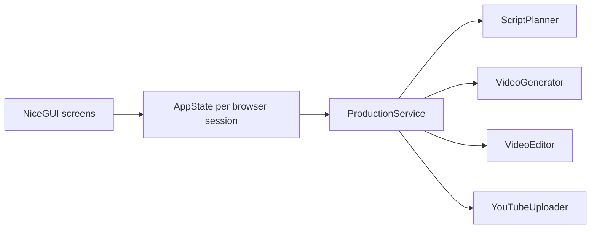

# ShortsMaker 🎬

Development map and agent handoff: [docs/README.md](docs/README.md), [docs/STATUS.md](docs/STATUS.md), and [docs/DECISIONS.md](docs/DECISIONS.md). Codex and Claude Code share [AGENTS.md](AGENTS.md) as the project instruction entry.

AI-powered YouTube Shorts automation pipeline using **Google Veo 3.1** and **Gemini image generation**.
ShortsMaker researches, writes scripts, generates visuals, and can upload content to YouTube. Review source claims and the finished video before scaling publication.
Automatic uploads are private review copies; public publication remains a separate editorial decision.
Automatic API uploads conservatively mark AI-generated visuals for YouTube's synthetic-media disclosure. The manual Publishing tab requires an explicit yes/no choice about realistic AI-generated or altered scenes; review that choice again before making a video public.
Studio and scheduled API uploads are always **private**. Review the complete video, source claims, music rights, and AI disclosure choice in YouTube before making it public; the technical quality check does not make an editorial decision.

---

## ✨ Key Features

- **Deep Content Research:** A 3-stage enrichment pipeline (Extraction, Analysis, Enrichment) gathers context and web leads. Script validation compares concrete claims with the selected primary source excerpt.
- **Smart Storytelling:** Automatically structures scripts into high-retention formats (Hook -> Mystery -> Secret -> Impact).
- **Flexible Visuals:** A short Veo opening followed by Gemini images by default; full-image and full-video modes remain available.
- **Automated Composition:** Native integration with `moviepy` for seamless audio-visual merging, subtitling, and BGM.
- **Modern GUI:** A clean, productive Studio interface built with **NiceGUI**.

---

## 🏗️ Architecture

ShortsMaker is a modular monolith. The NiceGUI screens keep browser-session UI state in
`AppState` and start work through `ProductionService`. That service owns the production
sequence and progress/cancellation state; it calls the planner, media generator, editor,
and uploader. Those components contain their own external API and file operations.



The scheduler uses the same `ProductionService` without a GUI session. Browser state is
held in memory and is lost on a server restart. API settings are process-wide, so run
separate server instances when different users need different credentials.

An article enters topic history only after its script passes validation. Studio progress
tracks completed editing work and finishes after an optional upload. Stop requests wait
for the current external API call to return before the run is released.
RSS planning may end without a script when every candidate is declined or topic scoring
fails; it no longer forces a highest-score or random article into paid drafting. A direct
URL supplied by the user still follows its own source-validation path.
Planning rejects scripts without source text and asks the editorial validator to reject
claims or visual scenes that conflict with the supplied excerpt. Generated visual briefs
favor one source-grounded moment and illustrative diagrams when a realistic reconstruction
could be mistaken for actual footage. This is an LLM review, not independent fact
verification; review published material against its source.

Production estimates new visual API output cost before narration or media generation and
stops if it exceeds `MAX_VISUAL_COST_USD`. Veo makes one attempt by default; an explicitly
higher attempt count reserves that many outputs in the estimate. This is a planning limit, not a provider billing
cap: prompt tokens, GPT, TTS, provider-side retries, and taxes are excluded. It then checks narration length before
requesting Veo or Gemini media. It also checks for documented music before TTS or visual requests. Scene files in `outputs/clips/scenes/` are keyed by the
visual prompt, model, duration, and character overlay, so narration edits reuse them.
An automatic full run also checks the writer's minimum six-scene visual cost and local Google monthly room before paying to plan a new script. If that minimum cannot fit, the run stops and a repeating schedule pauses. Planning a script on its own still works; an approved script with retained clips follows its separate reuse path.
Changes to the Veo prompt wrapper invalidate only Veo scene cache entries.
When a silent scene clip is shorter than its narration, the editor holds its final frame instead of restarting or retiming the animation. Review long static holds before publication.
The editor matches each narration scene to about -18 LUFS before mixing, fades the selected BGM at the start and end, then normalizes the final audio locally after rendering; this adds no API request. Prepared caller-owned narration files are retained for later edits.
An automatic script with a mood outside the supported list stops before narration or visuals instead of silently switching to energetic music. A repeating schedule pauses for music selection. Matching a broad mood to a documented track still needs a full listen against the script's `music_direction` before publication.
Automatic narration uses OpenAI. It retries a transient connection or server failure once, then stops with the original error; it does not silently switch to a different voice provider.
Planning, analysis, enrichment, and editorial validation disable OpenAI SDK automatic retries. A new candidate or manual rerun can still make a separate paid request, so check provider usage before another round.
To retry a failed scene from the full pipeline, keep the
script and run **Start Production** in the Generation tab; a new full pipeline run
plans a new script. Before completion and again before upload, the rendered video is
checked for Shorts length, 9:16 framing, an audio track, silent audio, and black frames.
Subtitles appear phrase by phrase inside the rendered frame; their timing is estimated from narration length and needs playback review. If a check fails, the video is retained
for preview but is not marked ready for upload.

---

## 🚀 Quick Start

### 1. Prerequisites
- Python 3.12+
- Google Cloud Project with Vertex AI enabled.
- OpenAI API Key.

### 2. Installation
```bash
# Clone the repository
git clone https://github.com/dev-mcpark/ShortsMaker.git
cd ShortsMaker

# Install as an editable package
pip install -e .
```

### 3. Setup Credentials
Place your secrets in the `config/credentials/` directory:
- `service_account.json`: Your Google Cloud Service Account key.
- `client_secrets.json`: Your YouTube OAuth 2.0 Client Secret.

Configure your API keys in `config/.env`:
```ini
OPENAI_API_KEY=sk-...
GCP_PROJECT_ID=your-project-id
```

### Music for a reviewable render

Place a track named for the selected mood (for example, `bgm/calm_review.mp3`) beside `bgm/calm_review.mp3.license.json`. The editor uses only tracks with a documented **no-attribution** license and a matching SHA-256 hash. Studio's **BGM Track** control lists verified title and artist credits and can select one exact file after listening; this choice overrides its broad **BGM Mood** setting. If the selected file disappears or fails its hash check, production stops before new paid planning rather than switching songs. Record the real title, artist, source page, and license after checking the source yourself:

New scripts may include a short `music_direction` brief. Studio shows it with the script so an editor can compare the chosen track with the story's emotional arc; the local production record keeps the brief and selected filename for review. Older scripts without this field still load.

```json
{
  "title": "Track title",
  "artist": "Artist name",
  "source_url": "https://www.youtube.com/audiolibrary",
  "license": "YouTube Audio Library standard license",
  "attribution_required": false,
  "sha256": "64-character SHA-256 of the exact MP3 file"
}
```

Run `shasum -a 256 bgm/calm_review.mp3` to obtain the hash. The code checks that the record matches the file; it cannot verify a license claim for you. [YouTube's Audio Library guide](https://support.google.com/youtube/answer/3376882?hl=en) explains its attribution filters. If no documented track exists, production stops before paid script planning; with an explicit mood it also requires a match then. Auto mood follows the finished script and checks for a matching track before narration or visual generation. Scheduled runs pause when no documented music is available or the requested mood has none, so they do not repeat avoidable paid attempts. Set BGM volume to `0` only for a deliberate silent draft. Older local MP3s without records are not selected.

The NASA review cut now tries [Mixkit's “Digital Clouds” by Alejandro Magaña (A. M.)](https://mixkit.co/free-stock-music/tag/technology/) for its `sci-fi` mood under the [Stock Music Free License](https://mixkit.co/license/modal/musicFree/). The owner's review rejected the previous “Feedback Dreams” bed for this story; it remains available only for the separate `mysterious` mood. The new track's record is `bgm/futuristic_digital_clouds.mp3.license.json`; the MP3 stays out of Git. On a new checkout, download that exact Mixkit track as `bgm/futuristic_digital_clouds.mp3` and confirm its SHA-256 matches the record. Mixkit permits its free music in commercial YouTube videos without attribution, subject to its terms; this record documents provenance, not Content ID clearance or musical fit. The Studio follows the script mood by default and exposes a BGM level slider. Its 20% starting level is for this louder track and needs playback review with the voice. A local review can select an exact documented filename with `--bgm-track`; an unavailable or mismatched file fails without choosing another song.

For a second NASA music audition, download [Mixkit's “Stylz” by Ahjay Stelino](https://mixkit.co/free-stock-music/tag/space/) as `bgm/futuristic_stylz.mp3` and check it against `bgm/futuristic_stylz.mp3.license.json`. Select it explicitly with `--bgm-track futuristic_stylz.mp3 --bgm-volume 0.12`. This comparison does not change the default `sci-fi` track. Both songs require listening with the narration before either is chosen for a final cut.

### Free local edit review

For an approved script that needs a final OpenAI voice, check the current model price and set a round ceiling before running `scripts/prepare_narration.py`. Its `--plan` mode makes no API calls and works with the paid switch off. A paid run requires an explicitly enabled `PAID_PRODUCTION_ENABLED` setting and an OpenAI key. It saves `scene_N.mp3` files and `narration.json` in the ignored output directory, so later local edits can reuse the same voice. The cumulative reserve includes one possible transient retry per scene; it is not a provider bill or an account-wide spending limit. For example:

```bash
python scripts/prepare_narration.py docs/nasa_field_test_review.json --output-dir outputs/evaluation/nasa_final_narration_nova --voice nova --max-cost-usd 0.02 --usd-per-million-characters 15 --plan
# After approving the script and budget, repeat without --plan and enable the paid switch for that command.
```

Prepare a source-checked script JSON, one `scene_N.mp4` for each scene in a clips directory, and exactly one `scene_N.aiff`, `.wav`, `.mp3`, or `.m4a` narration file per scene in an audio directory. Then run:

```bash
python scripts/local_review.py path/to/script.json path/to/clips path/to/audio --bgm-volume 0.2
# To audition the exact NASA candidate, add: --bgm-track futuristic_digital_clouds.mp3
# To audition a left-aligned caption panel, add: --subtitle-style card
# For a light diagram background, keep soft captions and add: --subtitle-color '#19384a'
# For reviewed local fact labels, add: --text-overlays path/to/overlays.json
```

The command requires every clip and narration file before starting, reuses `ProductionService` for captions, documented BGM, final quality checks, and the local sidecar, and makes no planning, TTS, visual API, or upload request. It works without `OPENAI_API_KEY` when narration files are prepared. An optional text-overlay JSON maps scene numbers to cues with `text`, scene-relative `start` seconds, and `x`/`y` pixel positions in the 1080×1920 edit; `end` defaults to the scene end. The local sidecar records these cues. [The NASA review script](docs/nasa_field_test_review.json) is a source-checked example; supply its clips and narration locally and run it through this command to avoid its paid `video` scene mode. Use `--bgm-volume 0` for a deliberate silent draft. Its output is a private review file; check source claims, caption timing, speech, and music by playback before treating it as a publication candidate.

To verify the complete edit and private upload path with an approved script, call `ProductionService.full_pipeline(approved_script=script, manual_clip_paths=clips, prepared_audio_paths=audio, auto_upload=True, upload_metadata=metadata)`. Supply one local clip and one retained narration file per scene, plus reviewed title, description, source credit, and `contains_synthetic_media=True`. Keep `PAID_PRODUCTION_ENABLED=false` for a zero-provider-generation run; any missing clip then stops before a visual API request. The resulting production sidecar records the quality result and YouTube ID. YouTube uploads from this app are fixed to **private**; a successful upload verifies delivery, not editorial acceptance or readiness to publish.

When prepared audio has `narration.json`, production checks every scene's text and audio file against that record before editing. Older scratch audio without a manifest can still be used for local comparisons; its script alignment must be checked by the reviewer.

To rebuild the NASA diagrams for the retained final narration, save the [NASA article's credited fleet photo](https://science.nasa.gov/blogs/planetary-expeditions/2026/09/15/nasa-field-tests-ai-fleet-capability-for-science-exploration/) locally as `outputs/evaluation/astra_fleet_nasa_bethany_theiling.jpg`, then run:

```bash
python scripts/render_nasa_storyboard.py --photo outputs/evaluation/astra_fleet_nasa_bethany_theiling.jpg --audio-dir outputs/evaluation/nasa_final_narration_nova --output-dir outputs/evaluation/nasa_nova_motion_clips
python scripts/local_review.py docs/nasa_field_test_review.json outputs/evaluation/nasa_nova_motion_clips outputs/evaluation/nasa_final_narration_nova --bgm-track futuristic_digital_clouds.mp3 --bgm-volume 0.2 --subtitle-style soft
```

The storyboard keeps each reveal on its authored cue while its progress indicator runs for the complete narration scene. Keep the photo and outputs outside Git; the commands use local files and no provider requests.

`--subtitle-style soft` remains the default; `card` changes only the caption presentation to a left-aligned translucent panel. `--subtitle-color` overrides the default white caption text for a local edit, such as a dark color on light diagrams; the sidecar records the chosen color. Compare styles with the same narration, visuals, and music before selecting a final treatment.

### 4. Run ShortsMaker Studio
```bash
# Start the GUI
shorts-maker
```
Launch your browser and go to `http://127.0.0.1:8080`. Studio binds to loopback on port 8080.

---

## 🛠️ Production plan and visual cost

1. **Generate a sourced, reviewable script.** Keep the existing content checks and review the hook, facts, and originality before publishing.
2. **Choose visuals by scene.** The default `hybrid` mode plans one 6-second silent Veo hook and Gemini stills for later scenes. The planner can choose a still hook when motion would imply undocumented footage. Each scene can set `visual_mode` to `image` or `video`; manual clips can replace individual scenes.
3. **Check expected spend, then reuse work.** `PAID_PRODUCTION_ENABLED=false` blocks new planning, narration, and visual calls through Studio, the scheduler, and `scripts/paired_review.py`. Complete local clips plus prepared narration still render through `scripts/local_review.py`. After setting a round budget and checking provider usage, enable the switch only for the authorized paid work; a standalone narration round can use an ephemeral environment override. The normal run also stops before visual generation if new visual outputs, including any explicit Veo attempt reserve, exceed `MAX_VISUAL_COST_USD` (default $1). The standalone character-video helper checks the same per-output cap and requests silent 720p footage for the overlay. The switch is permission to start paid work, not a monetary cap; completed visual scenes survive a failed run and narration changes.
4. **Inspect the finished video.** The editor checks length, framing, audio, and black frames before upload. It brings documented music tracks to a common starting loudness before applying the chosen BGM volume; listen to the complete speech/music mix because this cannot prove musical fit or prevent every moment of masking. The result shows expected visual API cost and reused scene count. Compare those estimates with the provider bill and YouTube retention data before increasing volume.

An explicit Veo retry allowance does not retry `429` or `RESOURCE_EXHAUSTED`; inspect provider usage before another production round. A request already submitted to the provider may still be billed.

Using the configured models, a new 6-scene hybrid video is estimated at about **$0.65** for visuals (6 seconds of Veo Fast at $0.08/second plus five Gemini images estimated at $0.034 each). Six still images are about **$0.20**; six 8-second Veo Fast clips are about **$3.84**. These are illustrative October 2026 planning rates, not full production costs. Check [Vertex AI pricing](https://cloud.google.com/gemini-enterprise-agent-platform/generative-ai/pricing) and [model lifecycle dates](https://docs.cloud.google.com/gemini-enterprise-agent-platform/models/model-versions) before raising budgets. The project's current [Google Cloud budget sends alerts only](https://docs.cloud.google.com/billing/docs/how-to/budgets); it does not stop charges. Check whether a supported [project and service spend cap](https://docs.cloud.google.com/billing/docs/how-to/budgets-spend-caps) is available before relying on one, and review OpenAI usage separately.

The production switch also stops direct OpenAI, Google, and Brave request helpers when off. Direct `VideoGenerator` calls check the configured visual-output cap for a full batch or one scene, and the character-video helper checks one clip. Direct planning, Brave, and `VideoEditor` TTS calls have no monetary preflight. The per-video estimate is not a bill and excludes planning, TTS, some input, and taxes, so check provider bills before each new paid round.
For a local Google monthly guard, set all four `GOOGLE_MONTHLY_BUDGET_KRW`, `GOOGLE_BUDGET_MONTH`, `GOOGLE_BUDGET_OPENING_KRW`, and `GOOGLE_USD_KRW_RESERVE_RATE` values in your private `config/.env` or root `.env`; see `config/.env.example`. The opening amount is the conservative account spend already incurred when this month's local ledger starts, including unresolved earlier requests. The rate is a deliberately cautious won-per-USD reservation factor, not a live exchange rate. The month follows [Cloud Billing's Pacific calendar](https://docs.cloud.google.com/billing/docs/how-to/reports). After checking the opening amount, run `.venv/bin/python -m shorts_maker.services.google_budget --init` once to create the ignored ledger; run the same command without `--init` to see the opening amount, per-model app reservations, and remaining room. The initializer refuses to overwrite a ledger. If it is deleted, new requests stop; restore its reservations or add them to the opening amount before initializing again. Known image and silent 720p Veo models reserve before each Google request; parallel requests cannot jointly pass the remaining budget. Failed or interrupted requests remain reserved until their bill can be reconciled. An exhausted or outdated monthly setting blocks Google requests and pauses an affected repeating schedule. A new automatic full run checks the writer's minimum visual reserve before OpenAI planning and the exact visual batch before narration, including each request's won rounding; a passing minimum does not guarantee that the eventual script will fit. This guard covers this app's new Google visual calls only; it cannot see other projects, delayed Cloud Billing charges, provider-side extras, or taxes. Keep the Cloud Billing budget and bill checks as separate safeguards.
If a scheduled run receives provider `429` or `RESOURCE_EXHAUSTED`, that schedule pauses instead of buying planning and narration again at its next time. Check provider usage and the failed run before manually re-enabling it; the error alone does not distinguish quota from temporary capacity.
The same schedule pause applies when a submitted Veo operation finishes or times out without a verified video file. Reconcile its request record and provider bill before re-enabling the schedule; an explicit in-run server-error retry allowance still uses its reserved attempts.
An OpenAI rate limit during topic scoring, article analysis, enrichment summarization, or script validation also stops the current planning round instead of trying another paid topic or model call.

---

## 🤝 Contributing
Contributions are welcome! Please read our [CONTRIBUTING.md](CONTRIBUTING.md) for details on our code of conduct and the process for submitting pull requests.

---

## 📜 License
This project is licensed under the MIT License - see the [LICENSE](LICENSE) file for details.
