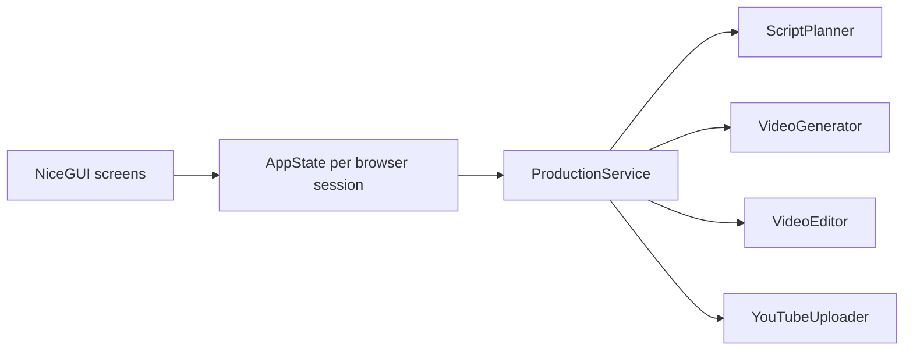

# ShortsMaker 🎬

Development map and agent handoff: [docs/README.md](docs/README.md), [docs/STATUS.md](docs/STATUS.md), and [docs/DECISIONS.md](docs/DECISIONS.md). Codex and Claude Code share [AGENTS.md](AGENTS.md) as the project instruction entry.

AI-powered YouTube Shorts automation pipeline using **Google Veo 3.1** and **Gemini image generation**.
ShortsMaker aims to produce and upload source-grounded Korean Shorts continuously within a controlled budget, improving quality and audience results toward eventual YouTube revenue. It researches, writes scripts, generates visuals, and can upload content to YouTube. Review source claims and the finished video before scaling publication.
Automatic uploads are private review copies; public publication remains a separate editorial decision.
Automatic API uploads conservatively mark AI-generated visuals for YouTube's synthetic-media disclosure. The manual Publishing tab requires an explicit yes/no choice about realistic AI-generated or altered scenes; review that choice again before making a video public.
Studio and scheduled API uploads are always **private**. The Studio Publishing tab plays the exact finished file selected for manual upload; watch it and check the metadata before uploading. Review the complete video, source claims, music rights, and AI disclosure choice in YouTube before making it public; the technical quality check does not make an editorial decision.
New API uploads label Korean title and description text with YouTube's `defaultLanguage=ko`; this does not alter earlier uploads or set the spoken-audio language. The current Sillim public-metadata proposal and remaining release checks are in [docs/SILLIM_PUBLICATION_CANDIDATE.md](docs/SILLIM_PUBLICATION_CANDIDATE.md).
The upload action requires the matching, quality-passed `*.production.json` record. New records bind the finished MP4 by SHA-256; changing its bytes blocks upload or reuse of a recorded YouTube ID. An older unuploaded record gains that binding after a fresh quality check, while an older uploaded record without a hash requires a YouTube Studio check. Repeating the action for an unchanged file with a recorded ID shows the existing private upload instead of posting another copy; metadata typed on that repeat is not submitted. Before each new upload, an adjacent `*.upload-pending.json` file records the video hash and prepared private request fields. Successful uploads also save those fields in the ignored production sidecar, so the submitted description can be checked later. If YouTube returns no ID or saving the ID fails, the pending file prevents another upload until the result is checked in YouTube Studio. If Studio confirms no upload occurred, remove the pending file before retrying; if it confirms an upload, record its verified ID in the matching production sidecar before clearing the pending file. Do not clear it based only on a network error.
Studio's **Load Metadata from Script** fills the selected primary article URL and any `supporting_source_urls` when absent; review or edit the description before a manual upload. A new upload must include every source URL saved in its production record. The explicit approved-script upload path checks supplied metadata and all script source URLs before rendering. A reviewed description is kept as written when it passes this check. Older production records without supporting-source metadata cannot establish whether a multi-source story is fully credited; rebuild such a cut from the reviewed script before uploading it.
The private scorecard separates unique image/hybrid comparison pairs from all other finished cuts, including routine automatic videos, and shows a distinct-primary-source cost rollup across revisions. It counts audience results only after `public_release_confirmed=yes` is entered for a reviewed video; an upload ID alone is not a public-release record. See [the evaluation workflow](docs/QUALITY_EVALUATION.md).

---

## ✨ Key Features

- **Deep Content Research:** A 3-stage enrichment pipeline (Extraction, Analysis, Enrichment) gathers context and web leads. Script validation compares concrete claims with the selected primary source excerpt.
- **Smart Storytelling:** Automatically structures scripts into high-retention formats (Hook -> Mystery -> Secret -> Impact).
- **Flexible Visuals:** A short Veo opening followed by Gemini images by default; full-image and full-video modes remain available.
- **Automated Composition:** Native integration with `moviepy` for seamless audio-visual merging, subtitling, and BGM.
- **Modern GUI:** A clean, productive Studio interface built with **NiceGUI**.

---

## 🏗️ Architecture

ShortsMaker is a modular monolith. The NiceGUI screens keep browser-session UI state in
`AppState` and start work through `ProductionService`. That service owns the production
sequence and progress/cancellation state; it calls the planner, media generator, editor,
and uploader. Those components contain their own external API and file operations.



The scheduler uses the same `ProductionService` without a GUI session. Browser state is
held in memory and is lost on a server restart. API settings are process-wide, so run
separate server instances when different users need different credentials.
Use **각본별 음성·음악 설정 저장** after choosing the voice, exact BGM, mood and level. Loading that same script from recent scripts or its schedule restores these choices after a restart; loading a different script without saved choices uses the audio defaults. Records stay under ignored `outputs/audio_choices/` and contain no API key or review/spend approval. A corrupt record or unavailable saved track blocks loading instead of substituting other music. Script review must still be confirmed after loading.
Studio reports a scheduler start error if its job backend is unavailable or a saved job cannot be registered. If a newly created or edited job cannot be registered while the scheduler is running, that schedule is saved as disabled with `registration_failed`; correct the problem before re-enabling it. A schedule created disabled stays unregistered. The Active Schedules badge and green indicator count jobs with an actual next run; a merely enabled saved configuration is shown as waiting when the scheduler is stopped.
The default `Every 2 Weeks` option starts at the next selected local clock time after first activation and repeats every 14 days from that saved anchor, including after a Studio restart. `Every 4 Weeks` remains available for 28-day schedules. For ordinary Studio jobs, Studio and its Scheduler must be running for a job to fire; missed times are not replayed. The trigger begins a **planning** cycle, not a guaranteed video upload. It still pauses at script review and all later visual, budget, and private-upload gates remain in force.
Agent-operated schedules explicitly marked `review_operator=agent` use a separate, queue-only clock host. The host has its own Asia/Seoul timezone and can run while Studio is closed. At the saved interval slot it writes one disabled `operator_pending` attempt without provider calls. An explicit `first_run_at` may defer the first slot after a manual pilot. After a host gap, recovery queues only the latest due slot, records older skipped dates and lateness, and never buys a backlog. A queued or interrupted attempt cannot be skipped by toggling its switch.

The approved operator uses `scripts/operate_schedule.py` to continue that same attempt. `plan` captures immutable Google/OpenAI ledger baselines and spawns ordinary planning under reduced process ceilings; source/scene review still pauses as `script_review_pending`. This episode's new ceilings are Google ₩3,000 and OpenAI $0.30 inside monthly ₩10,000/$1. All reservations created since its baseline, including unknown/unallocated local requests, are conservatively counted across calendar months. Missing ledger rows or a stale monthly opening block new work. This is a request-reservation guard for normal project clients, not a provider account billing cap or an authorization/quality decision.

```bash
.venv/bin/python scripts/operate_schedule.py status
.venv/bin/python scripts/operate_schedule.py plan SCHEDULE_ID
.venv/bin/python scripts/operate_schedule.py run SCHEDULE_ID -- .venv/bin/python EXISTING_PRODUCTION_SCRIPT
.venv/bin/python scripts/operate_schedule.py attach SCHEDULE_ID outputs/FINISHED_VIDEO.mp4
```

Replace the uppercase placeholders with the current queued ID and reviewed local artifacts. Run paid planning/media only under the existing operating authorization, after current-period usage and model prices are verified. Use `run` for subsequent normal first-frame/raw/TTS/editor/private-upload paths; it pins Lite and limits new visual reservations to the remaining scope without turning on Studio's global paid switch. The operator still inspects the actual source, first frame, raw and complete edit; a generic child command is not a quality verdict. Preserve initial and revised scripts, and explicitly reconcile the saved pending script if editorial changes are needed; attach requires its exact final script/video hashes. Each child has an exclusive pending marker and an exit-code audit. If a parent disappears, reconcile its child, provider and artifact state before touching that marker. Do not interpret a nonzero exit as permission to retry.

`attach` records a confirmed matching private upload on the paused schedule and exposes its YouTube link. It does not accept the video. The owner then uses **비공개 영상 검토 완료**; only that decision marks acceptance and resumes the next RSS slot. Public release remains separate.

On macOS, `.venv/bin/python scripts/operate_schedule.py install-host` installs the queue-only `com.shortsmaker.scheduler` user LaunchAgent with the paid switch off. Use `launchctl print gui/$(id -u)/com.shortsmaker.scheduler` to verify its current state, not a saved PID or config alone. Logs are under ignored `logs/scheduler_host.*.log`. The host checks external schedule edits every 30 seconds. A Codex heartbeat continues editorial work and development; it needs the desktop app available. Login, sleep and offline periods can delay execution; a running LaunchAgent is not proof of a real completed scheduled episode. The host does not wake the computer or run paid production by itself.

For this local operating setup, Studio also has a separate user LaunchAgent, `com.shortsmaker.studio`, loading `.venv/bin/python -m shorts_maker.gui` from the project root with `PAID_PRODUCTION_ENABLED=false`. Its definition is `~/Library/LaunchAgents/com.shortsmaker.studio.plist`, with `RunAtLoad=true`, restart on unsuccessful exit and a 30-second throttle; ignored logs are `logs/studio_host.{out,err}.log`. Open [ShortsMaker Studio](http://127.0.0.1:8080). Check the live job with `launchctl print gui/$(id -u)/com.shortsmaker.studio`. After testing a code change, wait for any Studio work to finish, then use `launchctl kickstart -k gui/$(id -u)/com.shortsmaker.studio` to load it; verify the HTTP response and retained artifacts afterward. This restarts Studio and clears unsaved browser-session state, so save script audio choices first. Leave `com.shortsmaker.scheduler` running independently and do not start a second clock from Studio. To intentionally unload Studio, use `launchctl bootout gui/$(id -u)/com.shortsmaker.studio`; the installed definition still loads on the next login. This is a logged-in local service, so sleep/logout/power loss can interrupt availability; Codex development checks still require the desktop app available.

Development checks have their own cadence, independent of the production clock; [STATUS.md](docs/STATUS.md) owns the current configured times and verification. Finished-cut feedback can trigger a code, prompt, workflow or retained-asset improvement immediately. Do not wait for the next upload or seven-day analytics to fix a supported issue. Verify and commit each concrete improvement, then check its effect in a later complete cut. More frequent development does not authorize extra paid generations, uploads or episode allowances. With no new evidence or unfinished improvement, leave the working system alone.

Each new muted Veo scene request carries the displayed scene estimate as its request ceiling, separately from the full-video visual cap and monthly ledger. If the current estimate rises above that displayed amount, the request stops before creating an attempt marker; refresh and review the new estimate. This ceiling controls the program's output reservation, not the provider invoice or editorial approval.
Use RSS discovery for repeating episodes. In Studio, choose one registered RSS category or `전체 분야`; the same choice applies to planning and schedules. The former free-text keyword field did not filter feeds. A saved legacy schedule with a non-category keyword stops before scoring, so recreate it with a registered category. Scheduled planning runs in one app process one at a time so the next run sees the updated source history and budget. A schedule with one direct article URL pauses after its first planned script, and another schedule for that same article stops as `duplicate_url` before paid work. Change the URL for a new story. Empty, local, and non-HTTP article URLs are rejected when saving the schedule.
The current scheduled run creates a source-validated script, saves it in the ignored schedule record, and pauses as `script_review_pending` **before narration, visuals, or upload**. On its Studio card, choose **검토할 각본 불러오기**, open Workspace → Script Editor, review the source, narration, and each scene description, then click **각본·장면 설명 확인 완료**. For each new Veo scene, Generation requires a local 9:16 PNG/JPEG first frame: preview it beside the narration and sources, state what must appear and what must be avoided, and approve it. Use **이 장면 Veo 원본 생성** for one scene, watch its muted raw clip, write a verdict note, and choose **원본 승인** or **원본 제외**. Repeat for every Veo scene before **Start Production**; it will use only approved cached Veo clips and then prepare narration, remaining images, and the complete edit. Changing the script, frame, or raw clip invalidates the matching verdict. Check the shown model/seconds/cost estimate and current budget before clicking a paid generation button. Publishing handles a separate private-upload review. A pending script cannot be resumed into another paid planning run.
After the whole cut has been reviewed and uploaded privately, use **비공개 영상 검토 완료** on that schedule card and enter the finished MP4 path. Studio requires a matching source, a passing production record and unchanged video hash, plus a confirmed private YouTube upload ID before saving the editorial acceptance. Only then does an RSS schedule return to its next reserved discovery time; a direct-URL schedule stays stopped. If the paid-work switch and monthly ledgers are active, the next RSS reservation can spend on a new plan. To skip the script instead, choose **각본 제외**: an RSS schedule resumes at its next reserved time, while a direct-URL schedule remains stopped and remembers that URL. The confirmation records private-review acceptance, not public-release approval or an automatic judgment of the footage. Legacy schedule cards may still show a previously rendered MP4 or private YouTube link; those retained records do not make the video public or resume the schedule.
New staged Veo requests keep a script/frame-bound request record under ignored `outputs/evaluation/visual_reviews/` before submission. Studio recovers the same saved raw clip after model or duration defaults change, preserves its existing verdict, and reuses approved footage in production without another visual charge. Missing, altered, corrupt or unfinished recorded results stop before another call; reconcile them rather than deleting records to retry. A newly approved different frame or changed script has its own identity. Older clips without these records still use their original model-specific cache and need explicit reconciliation to recover under other defaults. The script preview shows the whole visual estimate before reuse; actual staged and production preflights deduct saved clips.
For image-to-video, the reviewed frame supplies the scene and style; the request uses its motion instruction without repeating the static scene description or redesigning caption space. Text-only video prompts retain that description. A prompt-wrapper version change requires renewed frame/request review for new staged generation and cannot silently resubmit an older receipt. Existing accepted media remains usable through explicit local-clip editing; no regeneration is required merely because code changed.
Each new scheduled attempt archives the preceding attempt in the ignored `schedules.json` and clears its script, video, upload ID and acceptance from the new attempt. Execution History shows the latest ten attempts across schedules, including retained script titles; pending reviews are amber and accepted private reviews are green. The complete saved history remains in that local file. Legacy schedules preserve only the latest result still available when the next attempt begins; overwritten older runs cannot be recovered. Attempt history alone does not establish consecutive four-week uploads or reconcile billed costs.
Before paying for RSS topic scoring, run `.venv/bin/python scripts/preview_rss_candidates.py --category City_Life --category Finance_Economy --category Life_Tips` to inspect the same bounded lead pool in a uniquely named `outputs/evaluation/rss_candidate_preview_*.html` page; the command prints its path so later source checks do not overwrite it. With the same feeds and reviewed-URL history on the same day, discovery returns the same shortlist and order; new feed entries, cross-category duplicate links, a new day, or a completed review can change a category-only preview relative to a full run. Discovery reads each configured feed and alternates eligible leads between feeds within each category, while keeping at most five leads per category for paid scoring; this can add public RSS fetches. The preview needs no `OPENAI_API_KEY` and does not call OpenAI, Google, or YouTube. Titles and feed excerpts are leads, so open a promising original article and use Studio's direct-URL path only after checking its story, date, and source claims. If every feed fails or returns a non-RSS page, the command fails instead of reporting no story. An empty preview means at least one feed was read but can still hide failures in other feeds; check the collection logs.
An automatic RSS run scores the bounded pool once. It may mark up to the configured topic-attempt count (five by default) as promising leads for sequential full-article checks, starting with the highest score; a short article or rejected story does not buy a second score request in that run. Studio labels these leads as first-pass selections and identifies the one that yielded the accepted script. Source analysis, script validation, and the visual budget gate still run before production.
For a source-checked draft, run `.venv/bin/python scripts/prepare_scratch_narration.py docs/jamsu_bridge_review_draft.json --output-dir outputs/evaluation/jamsu_bridge_20261021/scratch_audio_v2`. On macOS this uses the local Yuna voice and writes script-bound scene audio, `story_audio.m4a`, and `story_review.html` under ignored `outputs/`; a rerun reuses verified scene audio. The page links primary and supporting source URLs for manual checking. It makes no provider call or visual/BGM asset, and the page does not approve the story or verify its source claims. The local speech service may need OS permission in a sandboxed host.
Add `--all-recent` to write a uniquely named `outputs/evaluation/rss_candidate_inventory_*.html` page with recent leads from readable feeds that pass the same URL, age, history, and summary-length filters. It removes only the five-per-category sampling cap for free editorial browsing; scheduled paid scoring still sees at most five per category. The page shows the feed's publication date when present. Check the collection log for failed feeds; a missing date or attractive headline still needs an original-article check before script or visual production.

RSS article URLs enter topic history after a definite rejection or a validated script;
uncertain provider failures do not mark them reviewed. Studio progress
tracks completed editing work and finishes after an optional upload. Stop requests wait
for the current external API call to return before the run is released.
RSS planning may end without a script when every candidate is declined, topic scoring
fails, selected articles cannot yield at least 100 words of body text, or the existing
article analysis cannot support an explanatory story with a substantive sentence copied
from that body. For RSS, the existing analysis call is asked to distinguish a verified
choice or mechanism from a future announcement; the app stops before enrichment and
script writing if the answer is missing, negative, or unsupported by the article text.
An unavailable or malformed analysis pauses a repeating schedule as `analysis_failed` so
the next trigger does not repeat a paid analysis. A valid negative story-fit verdict
just rejects that candidate within the bounded topic search.
An unavailable or malformed topic-scoring response similarly pauses the schedule as
`scoring_failed`; a valid response that selects no candidate simply ends that run.
Other planning exceptions, including a failed script-validation request, pause as
`planning_failed`; an actual editorial rejection can still try another source.
A short RSS summary alone does not trigger paid script writing. The body extractor
favors precision so navigation text does not satisfy the 100-word boundary; pages
whose substantive facts live only in an attachment may be rejected. A direct URL
supplied by the user follows the same article-length boundary but remains a manual topic choice.
RSS discovery removes duplicate and disallowed article URLs before scoring. The paid
topic scorer receives each title and a short plain-text RSS excerpt, and considers
viewer stakes, source-checkable payoff, and whether the key relationship can be shown
in the footage. It asks to rate event guides and promotions conservatively unless a
source-backed problem, decision, and observed outcome make an explanatory story.
It may decline the pool; incomplete, duplicate, or multiply selected
score responses also stop planning before article analysis or visual spending. Feed
excerpts are leads only: selected claims still require extracted article text and
editorial review. A high model score is not editorial approval. A longer scoring prompt
can modestly increase OpenAI token use.
Automatic narration drafts use a calm, direct spoken Korean voice and a source-backed question only when it can be answered early. The 5–7 scene range follows the approved five-scene Sillim pilot, but generated scripts still need a full story and source review; the count itself is not a quality score.
Before visual generation, the production path checks each generated or prepared narration scene for duration and an audible signal. A silent or nearly silent scene stops the run even when BGM is available; a finished-video audio track alone cannot prove that speech survived the mix.
New source files use the same feeds as `rss_sources.json.example`, including Seoul City's official housing, transport, and economy feeds under `City_Life`, the Ministry of the Interior and Safety's press-release feed under `Life_Tips`, and the Bank of Korea's monetary-policy releases and St. Louis Fed's economics blog under `Finance_Economy`; this workspace's ignored `rss_sources.json` includes them too. The Seoul economy feed currently carries mostly local events and discounts, so it is grouped with city-life leads rather than using finance scoring slots. Broken feeds and a FeedBurner URL that currently serves an unrelated blog have been removed from the defaults; the two working HTTP feeds now use verified HTTPS addresses. Existing customized source files are preserved; add the Bank of Korea feed in Studio's Sources tab if your older file does not have it. Official press releases can still be promotional or describe expected benefits; inspect the article and its source claims before choosing a story. For U.S. economic stories, identify the U.S. setting in Korean narration and make original visuals instead of reusing publisher assets without rights review.
Planning rejects scripts without source text and asks the editorial validator to reject
claims or visual scenes that conflict with the supplied excerpt. Generated visual briefs
favor one source-grounded moment and illustrative diagrams when a realistic reconstruction
could be mistaken for actual footage. This is an LLM review, not independent fact
verification; review published material against its source.

Production estimates new visual API output cost before narration or media generation and
stops if it exceeds `MAX_VISUAL_COST_USD`. Veo makes one attempt by default; an explicitly
higher attempt count reserves that many outputs in the estimate. This is a planning limit, not a provider billing
cap: prompt tokens, GPT, TTS, provider-side retries, and taxes are excluded. It then checks narration length before
requesting Veo or Gemini media. It also checks for documented music before TTS or visual requests. Scene files in `outputs/clips/scenes/` are keyed by the
visual prompt, model, duration, and character overlay, so narration edits reuse them.
An automatic planning run also checks the writer's five-scene visual baseline and local Google monthly room before paying to plan a new script. In `hybrid`, that baseline assumes one video hook plus four images (currently $0.616 with a 6-second Veo Fast hook); choose `image` mode if the cap only fits stills. The script may choose a still hook, but the preflight protects the normal moving-hook option. Automatic scripts must contain 5–7 scenes; a malformed scene count stops planning before validation. If the baseline cannot fit, the run stops and a repeating schedule pauses. A successful run ends with a script review pause, not a generated video. An explicitly approved script with retained clips follows its separate reuse path.
Changes to the Veo prompt wrapper invalidate only Veo scene cache entries.
When a silent scene clip is shorter than its narration, the editor holds its final frame instead of restarting or retiming the animation. Review long static holds before publication.
The editor matches each narration scene to about -18 LUFS before mixing, fades the selected BGM at the start and end, then normalizes the final audio locally after rendering; this adds no API request. Prepared caller-owned narration files are retained for later edits.
An automatic script with a mood outside the supported list stops before narration or visuals instead of silently switching to energetic music. A repeating schedule pauses for music selection. Matching a broad mood to a documented track still needs a full listen against the script's `music_direction` before publication.
Automatic narration uses OpenAI. It retries a transient connection or server failure once, then stops with the original error; it does not silently switch to a different voice provider.
Planning, analysis, enrichment, and editorial validation disable OpenAI SDK automatic retries. A new candidate or manual rerun can still make a separate paid request, so check provider usage before another round.
To retry a failed image scene, keep the reviewed script and run **Start Production** in the Generation tab; a new planning run selects a new script. For a Veo scene, review a new first frame or changed scene brief and use its one-scene raw request button. If the request ended without a verified clip, the saved `request.pending.json` blocks another attempt until you check its attempt record and provider bill; a timeout alone does not clear it. Before completion and again before upload, the rendered video is
checked for Shorts length, 9:16 framing, an audio track, silent audio, and black frames.
Subtitles appear phrase by phrase inside the rendered frame; their timing is estimated from narration length and needs playback review. If a check fails, the video is retained
for preview but is not marked ready for upload.

---

## 🚀 Quick Start

### 1. Prerequisites
- Python 3.12+
- Google Cloud Project with Vertex AI enabled.
- OpenAI API Key.

### 2. Installation
```bash
# Clone the repository
git clone https://github.com/dev-mcpark/ShortsMaker.git
cd ShortsMaker

# Install as an editable package
pip install -e .
```

### 3. Setup Credentials
Place your secrets in the `config/credentials/` directory:
- `service_account.json`: Your Google Cloud Service Account key.
- `client_secrets.json`: Your YouTube OAuth 2.0 Client Secret.

If YouTube upload authorization expires, run `.venv/bin/python -m shorts_maker.uploader.youtube_uploader --auth-only` and finish the browser sign-in. This reconnects the upload account without creating or uploading a video. A full run with private auto-upload checks saved authorization before paid planning and stops with `YOUTUBE_AUTH_REQUIRED` if it cannot refresh without interaction. The ordinary publishing action can still prompt for sign-in when used manually; an authentication failure before the media request leaves the reviewed video retryable.

Configure your API keys in `config/.env`:
```ini
OPENAI_API_KEY=sk-...
GCP_PROJECT_ID=your-project-id
```

### Music for a reviewable render

Place a track named for the selected mood (for example, `bgm/calm_review.mp3`) beside `bgm/calm_review.mp3.license.json`. The editor uses only tracks with a documented **no-attribution** license and a matching SHA-256 hash. Studio's **BGM Track** control lists verified title and artist credits and can select one exact file after listening; this choice overrides its broad **BGM Mood** setting. If the selected file disappears or fails its hash check, production stops before new paid planning rather than switching songs. Record the real title, artist, source page, and license after checking the source yourself:

New scripts may include a short `music_direction` brief. Studio shows it with the script so an editor can compare the chosen track with the story's emotional arc; the local production record keeps the brief and selected filename for review. Older scripts without this field still load.

```json
{
  "title": "Track title",
  "artist": "Artist name",
  "source_url": "https://www.youtube.com/audiolibrary",
  "license": "YouTube Audio Library standard license",
  "attribution_required": false,
  "sha256": "64-character SHA-256 of the exact MP3 file"
}
```

Run `shasum -a 256 bgm/calm_review.mp3` to obtain the hash. The code checks that the record matches the file; it cannot verify a license claim for you. [YouTube's Audio Library guide](https://support.google.com/youtube/answer/3376882?hl=en) explains its attribution filters. If no documented track matches an automatic mood, production stops before paid script planning; with an explicit mood it also requires a match then. Auto mood limits the script writer to moods with currently documented local tracks and asks it to abstain if none suits the story; a selected match is checked again before narration or visual generation. Scheduled runs pause when no matching music is available, so they do not repeat avoidable paid attempts. Set BGM volume to `0` only for a deliberate silent draft. Older local MP3s without records are not selected.
Studio lists manual BGM moods only when a currently verified track matches them; an already selected unavailable mood remains visible as unavailable so it can be changed deliberately. Auto follows the generated script within the available mood list. Choose a verified exact track before paid planning when testing a new topic outside the available mood catalogue.

The NASA review cut now tries [Mixkit's “Digital Clouds” by Alejandro Magaña (A. M.)](https://mixkit.co/free-stock-music/tag/technology/) for its `sci-fi` mood under the [Stock Music Free License](https://mixkit.co/license/modal/musicFree/). The owner's review rejected the previous “Feedback Dreams” bed for this story; it remains available only for the separate `mysterious` mood. The new track's record is `bgm/futuristic_digital_clouds.mp3.license.json`; the MP3 stays out of Git. On a new checkout, download that exact Mixkit track as `bgm/futuristic_digital_clouds.mp3` and confirm its SHA-256 matches the record. Mixkit permits its free music in commercial YouTube videos without attribution, subject to its terms; this record documents provenance, not Content ID clearance or musical fit. The Studio follows the script mood by default and exposes a BGM level slider. Its 20% starting level is for this louder track and needs playback review with the voice. A local review can select an exact documented filename with `--bgm-track`; an unavailable or mismatched file fails without choosing another song.

For a second NASA music audition, download [Mixkit's “Stylz” by Ahjay Stelino](https://mixkit.co/free-stock-music/tag/space/) as `bgm/futuristic_stylz.mp3` and check it against `bgm/futuristic_stylz.mp3.license.json`. Select it explicitly with `--bgm-track futuristic_stylz.mp3 --bgm-volume 0.12`. This comparison does not change the default `sci-fi` track. Both songs require listening with the narration before either is chosen for a final cut.

### Free local edit review

For an approved script that needs a final OpenAI voice, check the current model price and set a round ceiling before running `scripts/prepare_narration.py`. Its `--plan` mode makes no API calls and works with the paid switch off. A paid run requires an explicitly enabled `PAID_PRODUCTION_ENABLED` setting and an OpenAI key. It saves `scene_N.mp3` files and `narration.json` in the ignored output directory, so later local edits can reuse the same voice. The cumulative reserve includes one possible transient retry per scene; it is not a provider bill. The optional OpenAI monthly ledger below applies to each speech attempt as well. For example:

```bash
python scripts/prepare_narration.py docs/nasa_field_test_review.json --output-dir outputs/evaluation/nasa_final_narration_nova --voice nova --max-cost-usd 0.02 --usd-per-million-characters 15 --plan
# After approving the script and budget, repeat without --plan and enable the paid switch for that command.
```

Prepare a source-checked script JSON, one `scene_N.mp4` for each scene in a clips directory, and exactly one `scene_N.aiff`, `.wav`, `.mp3`, or `.m4a` narration file per scene in an audio directory. Then run:

```bash
python scripts/local_review.py path/to/script.json path/to/clips path/to/audio --bgm-volume 0.2
# To audition the exact NASA candidate, add: --bgm-track futuristic_digital_clouds.mp3
# To audition a left-aligned caption panel, add: --subtitle-style card
# For a light diagram background, keep soft captions and add: --subtitle-color '#19384a'
# For reviewed local fact labels, add: --text-overlays path/to/overlays.json
```

The command requires every clip and narration file before starting, reuses `ProductionService` for captions, documented BGM, final quality checks, and the local sidecar, and makes no planning, TTS, visual API, or upload request. It works without `OPENAI_API_KEY` when narration files are prepared. An optional text-overlay JSON maps scene numbers to cues with `text`, scene-relative `start` seconds, and `x`/`y` pixel positions in the 1080×1920 edit; `end` defaults to the scene end. For clip-specific label positions, add `_clip_sha256` as a map from every labeled scene number to the SHA-256 of its `scene_N.mp4`; a different clip then stops before rendering. The local sidecar records the cues. [The NASA review script](docs/nasa_field_test_review.json) is a source-checked example; supply its clips and narration locally and run it through this command to avoid its paid `video` scene mode. Use `--bgm-volume 0` for a deliberate silent draft. Its output is a private review file; check source claims, caption timing, speech, and music by playback before treating it as a publication candidate.

To verify the complete edit and private upload path with an approved script, call `ProductionService.full_pipeline(approved_script=script, manual_clip_paths=clips, prepared_audio_paths=audio, auto_upload=True, upload_metadata=metadata)`. Supply one local clip and one retained narration file per scene, plus reviewed title, description, source credit, and an explicit boolean `contains_synthetic_media` choice. This route rejects missing title, description, or AI disclosure choice before rendering; it cannot reuse a stale draft description by default. Keep `PAID_PRODUCTION_ENABLED=false` for a zero-provider-generation run; any missing clip then stops before a visual API request. The resulting production sidecar records the quality result and YouTube ID. YouTube uploads from this app are fixed to **private**; a successful upload verifies delivery, not editorial acceptance or readiness to publish.

When prepared audio has `narration.json`, production checks every scene's text and audio file against that record before editing. Older scratch audio without a manifest can still be used for local comparisons; its script alignment must be checked by the reviewer.

To rebuild the NASA diagrams for the retained final narration, save the [NASA article's credited fleet photo](https://science.nasa.gov/blogs/planetary-expeditions/2026/09/15/nasa-field-tests-ai-fleet-capability-for-science-exploration/) locally as `outputs/evaluation/astra_fleet_nasa_bethany_theiling.jpg`, then run:

```bash
python scripts/render_nasa_storyboard.py --photo outputs/evaluation/astra_fleet_nasa_bethany_theiling.jpg --audio-dir outputs/evaluation/nasa_final_narration_nova --output-dir outputs/evaluation/nasa_nova_motion_clips
python scripts/local_review.py docs/nasa_field_test_review.json outputs/evaluation/nasa_nova_motion_clips outputs/evaluation/nasa_final_narration_nova --bgm-track futuristic_digital_clouds.mp3 --bgm-volume 0.2 --subtitle-style soft
```

The storyboard keeps each reveal on its authored cue while its progress indicator runs for the complete narration scene. Keep the photo and outputs outside Git; the commands use local files and no provider requests.

`--subtitle-style soft` remains the default; `card` changes only the caption presentation to a left-aligned translucent panel. `--subtitle-color` overrides the default white caption text for a local edit, such as a dark color on light diagrams; the sidecar records the chosen color. Compare styles with the same narration, visuals, and music before selecting a final treatment.

### 4. Run ShortsMaker Studio
```bash
# Start the GUI
shorts-maker
```
Launch your browser and go to `http://127.0.0.1:8080`. Studio binds to loopback on port 8080.
On narrow screens, Studio stacks the workspace and settings below its navigation. The script preview's **new visual output estimate** follows the selected image, hybrid, or video mode and current model prices; it assumes one new output per scene before reuse. It excludes narration, planning, and actual provider charges. Switching to **Local File (Manual)** immediately shows scene upload cards, and a finished manual edit remains in that mode for review.

---

## 🛠️ Production plan and visual cost

1. **Generate a sourced, reviewable script.** Keep the existing content checks and review the hook, facts, and originality before publishing.
2. **Choose and review visuals by scene.** The default `hybrid` mode plans one 6-second silent Veo hook and Gemini stills for later scenes. The planner can choose a still hook when motion would imply undocumented footage. Each scene can set `visual_mode` to `image` or `video`; manual clips can replace individual scenes. New automatic Veo scenes require a reviewed local first frame and a separately accepted muted raw clip. The whole-cut action stops before narration or further visual spending while any raw clip is missing, rejected, or stale.
3. **Check expected spend, then reuse work.** `PAID_PRODUCTION_ENABLED=false` blocks new planning, narration, and visual calls through Studio, the scheduler, and `scripts/paired_review.py`. Complete local clips plus prepared narration still render through `scripts/local_review.py`. After setting a round budget and checking provider usage, enable the switch only for the authorized paid work; a standalone narration round can use an ephemeral environment override. The normal run also stops before visual generation if new visual outputs, including any explicit Veo attempt reserve, exceed `MAX_VISUAL_COST_USD` (default $1). The standalone character-video helper checks the same per-output cap and requests silent 720p footage for the overlay. The switch is permission to start paid work, not a monetary cap; completed visual scenes survive a failed run and narration changes.
4. **Inspect the finished video.** The editor checks length, framing, audio, and black frames before upload. It brings documented music tracks to a common starting loudness before applying the chosen BGM volume; listen to the complete speech/music mix because this cannot prove musical fit or prevent every moment of masking. The result shows expected visual API cost and reused scene count. Compare those estimates with the provider bill and YouTube retention data before increasing volume.

An explicit Veo retry allowance does not retry `429` or `RESOURCE_EXHAUSTED`; inspect provider usage before another production round. A request already submitted to the provider may still be billed. All Google SDK clients explicitly set one HTTP attempt per SDK request, so SDK retries cannot multiply the application's approved attempt allowance. Any permitted application-level retry remains separately reserved and recorded.

Using the configured models, a new 6-scene hybrid video is estimated at about **$0.65** for visuals (6 seconds of Veo Fast at $0.08/second plus five Gemini images estimated at $0.034 each). Six still images are about **$0.20**; six 8-second Veo Fast clips are about **$3.84**. These are illustrative October 2026 planning rates, not full production costs. Check [Vertex AI pricing](https://cloud.google.com/gemini-enterprise-agent-platform/generative-ai/pricing) and [model lifecycle dates](https://docs.cloud.google.com/gemini-enterprise-agent-platform/models/model-versions) before raising budgets. The project's current [Google Cloud budget sends alerts only](https://docs.cloud.google.com/billing/docs/how-to/budgets); it does not stop charges. Check whether a supported [project and service spend cap](https://docs.cloud.google.com/billing/docs/how-to/budgets-spend-caps) is available before relying on one, and review OpenAI usage separately.

The production switch also stops direct OpenAI, Google, and Brave request helpers when off. Direct `VideoGenerator` calls check the configured visual-output cap for a full batch or one scene, and the character-video helper checks one clip. OpenAI planning and TTS calls reserve against the optional monthly ledger when enabled; Brave remains outside both local ledgers. The per-video visual estimate is not a bill and excludes planning, TTS, some input, and taxes, so check provider bills before each new paid round.
For a local Google monthly guard, set all four `GOOGLE_MONTHLY_BUDGET_KRW`, `GOOGLE_BUDGET_MONTH`, `GOOGLE_BUDGET_OPENING_KRW`, and `GOOGLE_USD_KRW_RESERVE_RATE` values in your private `config/.env` or root `.env`; see `config/.env.example`. The opening amount is the conservative account spend already incurred when this month's local ledger starts, including unresolved earlier requests. The rate is a deliberately cautious won-per-USD reservation factor, not a live exchange rate. The month follows [Cloud Billing's Pacific calendar](https://docs.cloud.google.com/billing/docs/how-to/reports). After checking the opening amount, run `.venv/bin/python -m shorts_maker.services.google_budget --init` once to create the ignored ledger; run the same command without `--init` to see the opening amount, per-model, per-status, and source-linked app reservations, unattributed reservations, and remaining room. Status totals show estimated holds and request counts, not billed charges; failed or interrupted requests still count until their bill can be reconciled. Existing rows remain unattributed when the optional source column is added at the next reservation. The initializer refuses to overwrite a ledger. If it is deleted, new requests stop; restore its reservations or add them to the opening amount before initializing again. Known image and silent 720p Veo models reserve before each Google request; parallel requests cannot jointly pass the remaining budget. An exhausted or outdated monthly setting blocks Google requests and pauses an affected repeating schedule. Automatic planning checks the writer's minimum visual reserve before OpenAI planning; a later approved-script production checks the exact visual batch before narration, including each request's won rounding. A passing minimum does not guarantee that the eventual script will fit. This guard covers this app's new Google visual calls only; it cannot see other projects, delayed Cloud Billing charges, provider-side extras, or taxes. Keep the Cloud Billing budget and bill checks as separate safeguards.
For a separate local OpenAI monthly guard, set `OPENAI_MONTHLY_BUDGET_USD`, `OPENAI_BUDGET_MONTH`, and `OPENAI_BUDGET_OPENING_USD` in your private environment after reconciling this month's earlier OpenAI usage. The month uses UTC. Run `.venv/bin/python -m shorts_maker.services.openai_budget --init` once, then omit `--init` for the remaining balance and source-linked versus unattributed reservations. The ignored ledger reserves each GPT-4o/4o-mini request using the full output-token cap and a conservative input estimate, and each `tts-1` attempt by its character count. Automatic and standalone narration also check that the remaining monthly room covers every missing scene with the configured retry exposure before buying the first scene. Article-bound work and narration use the primary source URL; one RSS scoring call that covers several leads stays unattributed. Failed or uncertain requests stay reserved; unknown models, a missing ledger, and a stale month stop new OpenAI calls. Older rows also stay unattributed after the optional URL column is added on the next request. This is an app-local estimate, not an account spend cap or a bill. Recheck [current OpenAI pricing](https://developers.openai.com/api/docs/pricing) before enabling a new month. [OpenAI's deprecation notice](https://developers.openai.com/api/docs/deprecations) schedules the current `tts-1` for 2027-01-06 and GPT-4o/4o-mini for 2027-01-14; replacement models need contract, cost, and voice-quality tests before switching production.
Known model shutdown dates also stop new requests before reservation, even with the optional monthly budget disabled. A fresh automatic cycle checks speech availability by the recorded shutdown date before paid planning; a retired role pauses the schedule as `model_migration_required`. Existing retained audio/video can still be edited through the usual review gates. This date guard does not probe live account access or select a replacement automatically.

An enabled **schedule** requires both the Google and OpenAI monthly ledgers to be current, readable, and above zero remaining room before it starts production. A missing or exhausted ledger disables the schedule without buying a new episode. Manual, separately approved production still uses the optional budget settings described above. Do not initialize a ledger with an unverified opening amount merely to enable a schedule.
Two Studio instances using the same local `schedules.json` take turns entering scheduled production through an ignored SQLite lock file. The waiting instance reloads the saved schedule before spending, so a completed and paused episode is not started twice. Before a scheduled paid pipeline starts, its saved status becomes disabled `run_in_progress`; if the app stops mid-run, Studio shows that completion is unverified. Check retained outputs, request records, YouTube Studio if upload was enabled, and provider billing before manually resuming that schedule. A normal no-story RSS result re-enables discovery. This coordinates one local checkout, not different machines.
The Scheduler card shows when the paid-production switch or either monthly ledger is not ready. Its Running label means the clock is running; it does not mean a paid episode can pass those gates. A positive local ledger balance also does not approve a new paid round or guarantee the finished video fits its exact visual cap.
If every RSS feed is unreadable, the schedule records `source_unavailable` and checks again at its next time without buying a topic score. Inspect the feed logs if this repeats; the app will not use an older preview page as a substitute for current sources.
Current schedules pause after a validated script and do not render or upload automatically. The card retains the script for loading into Studio. Earlier schedule records may still have a local MP4 player or private YouTube review link; inspect those retained files before starting another episode. A no-story RSS result with no video can wait for the next source window.
If a scheduled run receives provider `429` or `RESOURCE_EXHAUSTED`, that schedule pauses instead of buying planning and narration again at its next time. Check provider usage and the failed run before manually re-enabling it; the error alone does not distinguish quota from temporary capacity.
For an earlier scheduled Veo request whose operation finished or timed out without a verified video file, the saved pause still requires request-record and provider-bill reconciliation before any retry.
Earlier runs that rendered a video but failed a final check or private upload remain paused as `rendered_failed`; inspect the retained MP4 and scheduler log before retrying its upload or editing it. Other failed results and unexpected exceptions pause the repeating schedule because planning may already have cost money. A normal `스크립트 생성 실패` result with no suitable source leaves RSS discovery enabled for the next source window; it can still incur new planning costs then.
RSS discovery keeps up to 500 reviewed article URLs in the ignored `url_history.json`: valid scoring rejections and articles rejected for short extraction, story fit, or script validation are skipped on later runs, as are accepted scripts. A provider or malformed-response failure does not mark a lead as reviewed. If the URL history is unreadable, planning stops before paid topic scoring; restore that file from a known-good copy. To revisit a rejected article deliberately, use the manual direct-URL route after checking its current facts.
An OpenAI rate limit during topic scoring, article analysis, enrichment summarization, or script validation also stops the current planning round instead of trying another paid topic or model call.

---

## 🤝 Contributing
Contributions are welcome! Please read our [CONTRIBUTING.md](CONTRIBUTING.md) for details on our code of conduct and the process for submitting pull requests.

---

## 📜 License
This project is licensed under the MIT License - see the [LICENSE](LICENSE) file for details.
